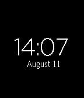

<!-- Generated by scripts/update_app_directory.py: do not edit by hand -->
[← All Pebble Developers](../developers.md)

# Vaibhav Viswanathan

*1 watchface · Last updated 2026-10-12 · [About these lists](../about-app-lists.md)*

Links: [Pebble App Store](https://apps.repebble.com/apps/dev/vaibhav-viswanathan_536c0359bcec8f44c7000013) · [GitHub (vaibhavviswanathan)](https://github.com/vaibhavviswanathan)

<h2 class="app-name" id="app-53e911811f0b5142030000f1"><a href="https://apps.repebble.com/53e911811f0b5142030000f1">Minimal</a> v2.2</h2>
<a class="app-source" href="https://github.com/vaibhavviswanathan/minimal" title="Source code" data-search-exclude>View source</a>

Watchface

Released 2014-08-11 Updated 2014-09-14

Runs on: Time 2, Pebble 2 Duo, Pebble 2, Time, Classic

Now with QuickTap Plus! This is a minimal watchface design. Shows the 24 hour time and the date in a light font. It notifies you when the Bluetooth is disconnected.. Shake your wrist to see more…

