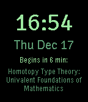

<!-- Generated by scripts/update_app_directory.py: do not edit by hand -->
[← All Pebble Developers](../developers.md)

# Val Packett

*1 watchface · Last updated 2026-10-12 · [About these lists](../about-app-lists.md)*

Links: [Pebble App Store](https://apps.repebble.com/apps/dev/val-packett_52f4bc5cc19ddfde8300060e) · [GitHub (valpackett)](https://github.com/valpackett)

<h2 class="app-name" id="app-52fd08542ace7afe350001de"><a href="https://apps.repebble.com/52fd08542ace7afe350001de">Classy Clock</a> v2.1</h2>
<a class="app-source" href="https://github.com/valpackett/classyclock" title="Source code" data-search-exclude>View source</a>

Watchface

Released 2014-02-13 Updated 2016-01-17

Runs on: Round 2, Time 2, Pebble 2 Duo, Pebble 2, Time Round, Time, Classic

A watchface that shows time to your next class (or time to the end of your current class). Must have for students. + Backup and restore your schedule to/from any notes app / text editor / whatever…

