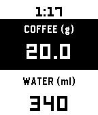

<!-- Generated by scripts/update_app_directory.py: do not edit by hand -->
[← All Pebble Developers](../developers.md)

# valerialaura

*1 app · Last updated 2026-10-12 · [About these lists](../about-app-lists.md)*

Links: [Pebble App Store](https://apps.repebble.com/apps/dev/valerialaura_53a46235694928d8ef0001b2) · [GitHub (valerialaura)](https://github.com/valerialaura)

<h2 class="app-name" id="app-69c9ca0340411f0009fd69a9"><a href="https://apps.repebble.com/69c9ca0340411f0009fd69a9">Simple coffee ratio calculator</a> v1.1</h2>
<a class="app-source" href="https://github.com/valerialaura/pebble-coffee-ratio" title="Source code" data-search-exclude>View source</a>

App

Released 2026-03-30 Updated 2026-09-23

Runs on: Time 2, Pebble 2 Duo, Pebble 2, Time

A coffee-to-water ratio calculator for your wrist. Set your brewing ratio once, then dial in coffee or water to get the matching amount instantly. Perfect for pour-over, when you weigh your beans…

