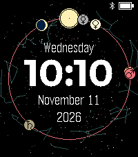

<!-- Generated by scripts/update_app_directory.py: do not edit by hand -->
[← All Pebble Developers](../developers.md)

# vapaavetehinen

*1 watchface · Last updated 2026-11-16 · [About these lists](../about-app-lists.md)*

Links: [Pebble App Store](https://apps.repebble.com/apps/dev/vapaavetehinen_3cc1cdc83f9d195cdef84d8a) · [GitHub (vapaavetehinen)](https://github.com/vapaavetehinen)

<h2 class="app-name" id="app-11a6e6ef55cb4c8b8aa71676"><a href="https://apps.repebble.com/11a6e6ef55cb4c8b8aa71676">Ecliptic 2</a> v1.0.1</h2>
<a class="app-source" href="https://github.com/vapaavetehinen/ecliptic-2" title="Source code" data-search-exclude>View source</a>

Watchface

GPL-3.0 Released 2026-11-11 Updated 2026-11-13

Runs on: Round 2, Time 2, Pebble 2 Duo, Pebble 2, Time Round, Time, Classic

Ecliptic 2 shows where the Sun, the Moon and the five naked-eye planets are along the ecliptic right now. The Sun is always at the top of the circle. Planets to its left are visible in the evening…

