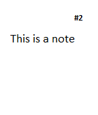

<!-- Generated by scripts/update_app_directory.py: do not edit by hand -->
[← All Pebble Developers](../developers.md)

# Vasyl Pasternak

*1 app · Last updated 2026-10-11 · [About these lists](../about-app-lists.md)*

Links: [Pebble App Store](https://apps.repebble.com/apps/dev/vasyl-pasternak_5319c49a05c740cd0f000084) · [GitHub (vasylp)](https://github.com/vasylp)

<h2 class="app-name" id="app-539c8fd657e2cccdad000036"><a href="https://apps.repebble.com/539c8fd657e2cccdad000036">MyNotes</a> v1.0</h2>
<a class="app-source" href="https://github.com/vasylp/pebblenotes" title="Source code" data-search-exclude>View source</a>

App

Released 2014-06-14 Updated 2014-06-14

Runs on: Time 2, Pebble 2 Duo, Pebble 2, Time, Classic

An easy to use notes app, that could contain up to 5 notes and stores them in the watch internal memory. So you won&#x27;t need to sync the application with your phone, or even connect to it.

