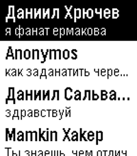

<!-- Generated by scripts/update_app_directory.py: do not edit by hand -->
[← All Pebble Developers](../developers.md)

# Veselcraft

*1 app · Last updated 2026-10-12 · [About these lists](../about-app-lists.md)*

Links: [Rebble App Store](https://apps.rebble.io/en_US/developer/6533d557c375090008b0c90b/1) · [GitHub (veselcraft)](https://github.com/veselcraft)

<h2 class="app-name" id="app-66310701ea09ac0e67193520"><a href="https://apps.rebble.io/en_US/application/66310701ea09ac0e67193520">Pebblakte</a> v2.1</h2>
<a class="app-source" href="https://github.com/veselcraft/pebblakte" title="Source code" data-search-exclude>View source</a>

App

Released 2024-04-30 Updated 2025-10-18 Rebble App Store

Runs on: Round 2, Time 2, Pebble 2 Duo, Pebble 2, Time Round, Time, Classic

Messaging app for VK and OpenVK. Below is description in Russian language. Мессенджер для VK и OpenVK. Для входа потребуется токен. Для ВК его можно сгенерировать так: зайти на vkhost.github.io…

