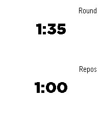
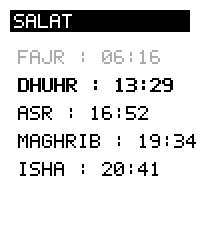

<!-- Generated by scripts/update_app_directory.py: do not edit by hand -->
[← All Pebble Developers](../developers.md)

# vhoen

*2 apps · Last updated 2026-10-11 · [About these lists](../about-app-lists.md)*

Links: [Pebble App Store](https://apps.repebble.com/apps/dev/vhoen_63dc3c53d7f92d271ff721cc) · [GitHub (vhoen)](https://github.com/vhoen)

<button type="button" data-filter="all" aria-pressed="true">All 2</button><button type="button" data-filter="watchface" aria-pressed="false" disabled>Watchfaces 0</button><button type="button" data-filter="watchapp" aria-pressed="false">Apps 2</button>

<label class="dev-sort">Sort by <select><option value="updated">Recently updated</option><option value="released">Newest release</option><option value="title">A–Z</option></select></label>

<h2 class="app-name" id="app-0d83b91c312c46c48f57753c"><a href="https://apps.repebble.com/0d83b91c312c46c48f57753c">Boxing Timer</a> v1.0.4</h2>
<a class="app-source" href="https://github.com/vhoen/pebble-boxing-timer" title="Source code" data-search-exclude>View source</a>

App

Released 2026-06-24 Updated 2026-09-25

Runs on: Round 2, Time 2

Timer which alternates between exercice timer and rest timer.

<h2 class="app-name" id="app-40c8c70ad768489f908b499e"><a href="https://apps.repebble.com/40c8c70ad768489f908b499e">Salat</a> v1.0.0</h2>
<a class="app-source" href="https://github.com/vhoen/pebble-salat" title="Source code" data-search-exclude>View source</a>

App

Released 2026-09-22 Updated 2026-09-22

Runs on: Round 2, Time 2

Displays Salat time for a given latitude. Using lat/lng instead of location in order to avoid using an api key from a geocoding provider.

