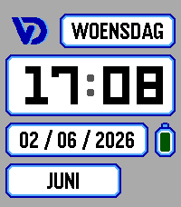

<!-- Generated by scripts/update_app_directory.py: do not edit by hand -->
[← All Pebble Developers](../developers.md)

# Vic Demuzere

*1 watchface · Last updated 2026-10-12 · [About these lists](../about-app-lists.md)*

Links: [Pebble App Store](https://apps.repebble.com/apps/dev/vic-demuzere_c3de5fcf1b946f5fa739ccd7) · [Website (vic.demuzere.be)](https://vic.demuzere.be)

<h2 class="app-name" id="app-ebdf505fb5194e159895b743"><a href="https://apps.repebble.com/ebdf505fb5194e159895b743">Vic&#x27;s Watchface</a> v0.4.3</h2>
<a class="app-source" href="https://git.dmzr.be/sorcix/pebble-watchface" title="Source code" data-search-exclude>View source</a>

Watchface

Released 2026-06-01 Updated 2026-06-03

Runs on: Time 2

Personal watchface. Shows only the information I want to see. No settings.

