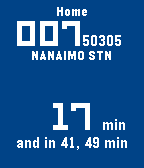

<!-- Generated by scripts/update_app_directory.py: do not edit by hand -->
[← All Pebble Developers](../developers.md)

# Victor Pineda

*1 app · Last updated 2026-10-12 · [About these lists](../about-app-lists.md)*

Links: [Rebble App Store](https://apps.rebble.io/en_US/developer/549209c69e2c1161f1000026/1) · [GitHub (vpineda1996)](https://github.com/vpineda1996)

<h2 class="app-name" id="app-59507a8d0dfc32aacf0015a2"><a href="https://apps.rebble.io/en_US/application/59507a8d0dfc32aacf0015a2">Transit</a> v0.5</h2>
<a class="app-source" href="https://github.com/vpineda1996/vantransit" title="Source code" data-search-exclude>View source</a>

App

Released 2017-06-26 Updated 2017-06-26 Rebble App Store

Runs on: Time 2, Time

Simple watchapp that gives you real-time updates for your saved bus stops and organizes them according to your current location. Press down to explore your saved stops or up to show nearby stops…

