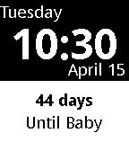

<!-- Generated by scripts/update_app_directory.py: do not edit by hand -->
[← All Pebble Developers](../developers.md)

# Vidal Graupera

*2 watchfaces and 1 app · Last updated 2026-10-11 · [About these lists](../about-app-lists.md)*

Links: [Pebble App Store](https://apps.repebble.com/apps/dev/vidal-graupera_52cd5df49505d12f12000056) · [GitHub (VGraupera)](https://github.com/VGraupera) · [Website (vidalgraupera.com)](http://www.vidalgraupera.com)

<button type="button" data-filter="all" aria-pressed="true">All 3</button><button type="button" data-filter="watchface" aria-pressed="false">Watchfaces 2</button><button type="button" data-filter="watchapp" aria-pressed="false">Apps 1</button>

<label class="dev-sort">Sort by <select><option value="updated">Recently updated</option><option value="released">Newest release</option><option value="title">A–Z</option></select></label>

<h2 class="app-name" id="app-52fa1f10afe0553671000211"><a href="https://apps.repebble.com/52fa1f10afe0553671000211">Countdown</a> v3.2</h2>
<a class="app-source" href="https://github.com/VGraupera/countdown-watchface" title="Source code" data-search-exclude>View source</a>

Watchface

MIT Released 2014-02-11 Updated 2014-05-02

Runs on: Time 2, Pebble 2 Duo, Pebble 2, Time, Classic

Shows much time to go until a date in the future, or since a date in the past. Useful to mark important upcoming milestones i.e. days until the big day, an important birthday or anniversary, when…

<h2 class="app-name" id="app-5304dcfe3985ada2bc000228"><a href="https://apps.repebble.com/5304dcfe3985ada2bc000228">Magic Watch</a> v1.0.0</h2>
<a class="app-source" href="https://github.com/VGraupera/magic-watch" title="Source code" data-search-exclude>View source</a>

App

MIT Released 2014-02-19 Updated 2014-02-19

Runs on: Time 2, Pebble 2 Duo, Pebble 2, Time, Classic

Now your watch has all the answers! Ask any question. Shake your watch. Get the answer.

<h2 class="app-name" id="app-52ed2a68281749bdca000036"><a href="https://apps.repebble.com/52ed2a68281749bdca000036">Note to Self</a> v1.0.1</h2>
<a class="app-source" href="https://github.com/VGraupera/note-to-self-watchface" title="Source code" data-search-exclude>View source</a>

Watchface

MIT Released 2014-02-01 Updated 2014-02-02

Runs on: Time 2, Pebble 2 Duo, Pebble 2, Time, Classic

Add a note to yourself that will be shown along with the date and time. Useful to keep track of goals, reminders, etc.

