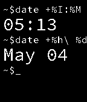

<!-- Generated by scripts/update_app_directory.py: do not edit by hand -->
[← All Pebble Developers](../developers.md)

# Vidia

*2 watchfaces · Last updated 2026-10-11 · [About these lists](../about-app-lists.md)*

Links: [Pebble App Store](https://apps.repebble.com/apps/dev/vidia_532614caaff3368e8d000358) · [GitHub (vidia)](https://github.com/vidia) · [Website (indyx.org)](http://indyx.org/)

<button type="button" data-filter="all" aria-pressed="true">All 2</button><button type="button" data-filter="watchface" aria-pressed="false">Watchfaces 2</button><button type="button" data-filter="watchapp" aria-pressed="false" disabled>Apps 0</button>

<label class="dev-sort">Sort by <select><option value="updated">Recently updated</option><option value="released">Newest release</option><option value="title">A–Z</option></select></label>

<h2 class="app-name" id="app-53a59b119580ed5b6300014e"><a href="https://apps.repebble.com/53a59b119580ed5b6300014e">XTERN</a> v1.0.0</h2>
<a class="app-source" href="https://github.com/vidia/xtern" title="Source code" data-search-exclude>View source</a>

Watchface

Released 2014-06-21 Updated 2014-06-21

Runs on: Time 2, Pebble 2 Duo, Pebble 2, Time, Classic

Xtern, the ultimate tech internship experience. Xtern is an initiative of IndyX which gathers talented interns to work at Indianapolis, IN&#x27;s fastest growing tech companies. Intens live together in…

<h2 class="app-name" id="app-53608b842d33b45e5900009f"><a href="https://apps.repebble.com/53608b842d33b45e5900009f">Pebble Terminal</a> v1.2.2</h2>
<a class="app-source" href="https://github.com/vidia/Pebble-Shell" title="Source code" data-search-exclude>View source</a>

Watchface

Released 2014-04-30 Updated 2014-05-14

Runs on: Time 2, Pebble 2 Duo, Pebble 2, Time, Classic

The Pebble Terminal turns your watch into a Linux terminal and uses the `date` command to print the time and day. Features: Larger time and date text than the competition! Familiar Linux syntax…

