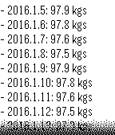
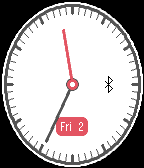

<!-- Generated by scripts/update_app_directory.py: do not edit by hand -->
[← All Pebble Developers](../developers.md)

# Viktor

*1 watchface and 1 app · Last updated 2026-10-11 · [About these lists](../about-app-lists.md)*

Links: [Pebble App Store](https://apps.repebble.com/apps/dev/viktor_546b743455e9392721000014) · [GitHub (vcsala)](https://github.com/vcsala)

<button type="button" data-filter="all" aria-pressed="true">All 2</button><button type="button" data-filter="watchface" aria-pressed="false">Watchfaces 1</button><button type="button" data-filter="watchapp" aria-pressed="false">Apps 1</button>

<label class="dev-sort">Sort by <select><option value="updated">Recently updated</option><option value="released">Newest release</option><option value="title">A–Z</option></select></label>

<h2 class="app-name" id="app-54c1918d146d67002f000096"><a href="https://apps.repebble.com/54c1918d146d67002f000096">WeightTracker</a> v1.2</h2>
<a class="app-source" href="https://github.com/vcsala/weighttracker.git" title="Source code" data-search-exclude>View source</a>

App

Released 2015-01-23 Updated 2019-07-24

Runs on: Round 2, Time 2, Pebble 2 Duo, Pebble 2, Time Round, Time, Classic

Simple, standalone pebble app to record, monitor and track weight loss (or gain) in the last 14 days period. Supports daily reminders and timeline pins. Both unit of measurement (kilograms…

<h2 class="app-name" id="app-560e51b0038c388d30000079"><a href="https://apps.repebble.com/560e51b0038c388d30000079">Elliptical</a> v1.1</h2>
<a class="app-source" href="https://github.com/vcsala/elliptical" title="Source code" data-search-exclude>View source</a>

Watchface

Released 2015-10-02 Updated 2016-01-20

Runs on: Round 2, Time 2, Pebble 2 Duo, Pebble 2, Time Round, Time, Classic

Elliptical is a ellipse shaped watchface where the hands follow the same shape. The shape of the dial follows the resolution of the watch (the shape will be a circle on a square shaped screen…

