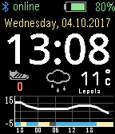

<!-- Generated by scripts/update_app_directory.py: do not edit by hand -->
[← All Pebble Developers](../developers.md)

# VilleV

*1 watchface · Last updated 2026-10-11 · [About these lists](../about-app-lists.md)*

Links: [Pebble App Store](https://apps.repebble.com/apps/dev/villev_5410911c047a6dc4e000020d) · [GitHub (vviskari)](https://github.com/vviskari)

<h2 class="app-name" id="app-58b516160dfc329c0100017e"><a href="https://apps.repebble.com/58b516160dfc329c0100017e">Simple TCS</a> v2.29</h2>
<a class="app-source" href="https://github.com/vviskari/SimpleTCS" title="Source code" data-search-exclude>View source</a>

Watchface

Released 2017-02-28 Updated 2018-04-21

Runs on: Time 2, Pebble 2 Duo, Pebble 2, Time, Classic

100 Hearts! Wow! Thanks for your support and feedback. Lets celebrate with an animation! Calendar and forecast switch is now animated and you can schedule the switch to happen every minute. Shows…

