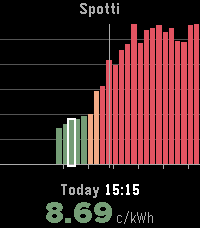
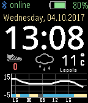

<!-- Generated by scripts/update_app_directory.py: do not edit by hand -->
[← All Pebble Developers](../developers.md)

# VilleV

*1 watchface and 1 app · Last updated 2026-10-19 · [About these lists](../about-app-lists.md)*

Links: [Pebble App Store](https://apps.repebble.com/apps/dev/villev_5410911c047a6dc4e000020d) · [GitHub (vviskari)](https://github.com/vviskari)

<button type="button" data-filter="all" aria-pressed="true">All 2</button><button type="button" data-filter="watchface" aria-pressed="false">Watchfaces 1</button><button type="button" data-filter="watchapp" aria-pressed="false">Apps 1</button>

<label class="dev-sort">Sort by <select><option value="updated">Recently updated</option><option value="released">Newest release</option><option value="title">A–Z</option></select></label>

<h2 class="app-name" id="app-a53edc8542dc454281c4f366"><a href="https://apps.repebble.com/a53edc8542dc454281c4f366">Spotti</a> v1.2.0</h2>
<a class="app-source" href="https://github.com/vviskari/spotti-pebble" title="Source code" data-search-exclude>View source</a>

App

Released 2026-10-15 Updated 2026-10-18

Runs on: Round 2, Time 2

Shows current and upcoming Finnish electricity spot prices as a bar chart. Prices include VAT. Scroll the chart with up/down buttons or drag with touch screen. Select button brings you back to…

<h2 class="app-name" id="app-58b516160dfc329c0100017e"><a href="https://apps.repebble.com/58b516160dfc329c0100017e">Simple TCS</a> v2.29</h2>
<a class="app-source" href="https://github.com/vviskari/SimpleTCS" title="Source code" data-search-exclude>View source</a>

Watchface

Released 2017-02-28 Updated 2018-04-21

Runs on: Time 2, Pebble 2 Duo, Pebble 2, Time, Classic

100 Hearts! Wow! Thanks for your support and feedback. Lets celebrate with an animation! Calendar and forecast switch is now animated and you can schedule the switch to happen every minute. Shows…

