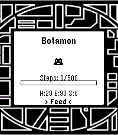
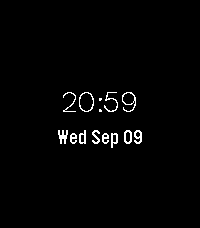

<!-- Generated by scripts/update_app_directory.py: do not edit by hand -->
[← All Pebble Developers](../developers.md)

# Vinayla

*2 watchfaces and 1 app · Last updated 2026-10-12 · [About these lists](../about-app-lists.md)*

Links: [Pebble App Store](https://apps.repebble.com/apps/dev/vinayla_cf9b8101421543277d0bbc02) · [GitHub (vinay1017)](https://github.com/vinay1017)

<button type="button" data-filter="all" aria-pressed="true">All 3</button><button type="button" data-filter="watchface" aria-pressed="false">Watchfaces 2</button><button type="button" data-filter="watchapp" aria-pressed="false">Apps 1</button>

<label class="dev-sort">Sort by <select><option value="updated">Recently updated</option><option value="released">Newest release</option><option value="title">A–Z</option></select></label>

<h2 class="app-name" id="app-5b595252b47f4f28ae51c39d"><a href="https://apps.repebble.com/5b595252b47f4f28ae51c39d">Digimon Digivice</a> v0.91</h2>
<a class="app-source" href="https://github.com/vinay1017/Pebble-Digivice" title="Source code" data-search-exclude>View source</a>

App

Released 2026-09-21 Updated 2026-10-12

Runs on: Round 2, Time 2

My take on a hybrid digivice + vital bracelet Digimon app! Follows the 25th anniversary BE DIM vital bracelet digivolution chart right now if you want to take a peek at how to digivolve to…

<h2 class="app-name" id="app-a757b4ff558e4308af4ea1b4"><a href="https://apps.repebble.com/a757b4ff558e4308af4ea1b4">Bakugo - My Hero Academia</a> v1.2</h2>
<a class="app-source" href="https://github.com/vinay1017/Pebble-BakugoWatchface" title="Source code" data-search-exclude>View source</a>

Watchface

Released 2026-09-12 Updated 2026-09-15

Runs on: Round 2, Time 2

I saw an image of bakugo where the text in the background said BOOM! and it was wonderfully comicbook-y. Took the image, removed the BOOM! and swapped in the time! Written all in C. Just tells…

<h2 class="app-name" id="app-bc1e47a42954410cb70e891b"><a href="https://apps.repebble.com/bc1e47a42954410cb70e891b">ValleySans Simple watchface</a> v1.0.0</h2>
<a class="app-source" href="https://github.com/vinay1017/Pebble-Font-Test" title="Source code" data-search-exclude>View source</a>

Watchface

Released 2026-09-10 Updated 2026-09-10

Runs on: Time 2

Genuinely the simplest watchface made with Alloy and testing out a font called ValleySans. And testing to see if the pebble #1621 bug report is still buggin&#x27;. Seems like it might be.

