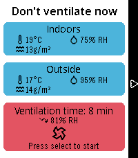
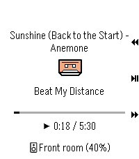
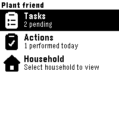
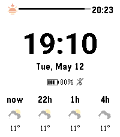
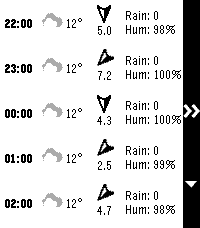
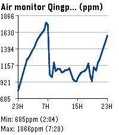

<!-- Generated by scripts/update_app_directory.py: do not edit by hand -->
[← All Pebble Developers](../developers.md)

# Vincent

*1 watchface and 5 apps · Last updated 2026-10-11 · [About these lists](../about-app-lists.md)*

Links: [Pebble App Store](https://apps.repebble.com/apps/dev/vincent_997a3d2f0b60fba729f7aece) · [GitHub (vincentezw)](https://github.com/vincentezw)

<button type="button" data-filter="all" aria-pressed="true">All 6</button><button type="button" data-filter="watchface" aria-pressed="false">Watchfaces 1</button><button type="button" data-filter="watchapp" aria-pressed="false">Apps 5</button>

<label class="dev-sort">Sort by <select><option value="updated">Recently updated</option><option value="released">Newest release</option><option value="title">A–Z</option></select></label>

<h2 class="app-name" id="app-9a25b4c1c01648f18cb13086"><a href="https://apps.repebble.com/9a25b4c1c01648f18cb13086">Ventilate</a> v1.0.0</h2>
<a class="app-source" href="https://github.com/vincentezw/ventilate-pebble" title="Source code" data-search-exclude>View source</a>

App

Released 2026-09-18 Updated 2026-09-18

Runs on: Round 2, Time 2

Calculate an optimal time for shock ventilation using sensors from Home Assistant. It calculates absolute humidity, tracks the time on your wrist and gives a summary of the results.

<h2 class="app-name" id="app-cbdd9cc7fab247d5b9a20d84"><a href="https://apps.repebble.com/cbdd9cc7fab247d5b9a20d84">Pebble MA</a> v2.1.0</h2>
<a class="app-source" href="https://github.com/vincentezw/pebble-ma" title="Source code" data-search-exclude>View source</a>

App

Released 2026-04-18 Updated 2026-09-04

Runs on: Round 2, Time 2

Pebble Music Assistant client

<h2 class="app-name" id="app-0af0a40d63c34ef4bb110074"><a href="https://apps.repebble.com/0af0a40d63c34ef4bb110074">Plant friend</a> v1.0.1</h2>
<a class="app-source" href="https://github.com/vincentezw/plantfriend-pebble" title="Source code" data-search-exclude>View source</a>

App

Released 2026-09-01 Updated 2026-09-01

Runs on: Round 2, Time 2, Pebble 2 Duo, Pebble 2, Time Round, Time, Classic

Pebble watchapp for Plant friend. Keep track of your plant care schedule directly from your watch.

<h2 class="app-name" id="app-12641b3cd36747d8bd8a617a"><a href="https://apps.repebble.com/12641b3cd36747d8bd8a617a">hassweather</a> v3.2.0</h2>
<a class="app-source" href="https://github.com/vincentezw/hassweather-nua" title="Source code" data-search-exclude>View source</a>

Watchface

Released 2026-04-13 Updated 2026-08-08

Runs on: Time 2, Pebble 2 Duo, Pebble 2, Time, Classic

Home Assistant weather forecast watchface with sunrise and sunset

<h2 class="app-name" id="app-408fed6ba0354a6db2e6c8f2"><a href="https://apps.repebble.com/408fed6ba0354a6db2e6c8f2">HA Forecast</a> v1.4.1</h2>
<a class="app-source" href="https://github.com/vincentezw/haforecast" title="Source code" data-search-exclude>View source</a>

App

Released 2026-04-25 Updated 2026-06-28

Runs on: Round 2, Time 2

Display hourly and daily forecast from a Home Assistant weather entity. Also shows sunrise and sunset times.

<h2 class="app-name" id="app-3939513e02874195bbdf06fd"><a href="https://apps.repebble.com/3939513e02874195bbdf06fd">hassgraph</a> v1.0.1</h2>
<a class="app-source" href="https://github.com/vincentezw/hassgraph-pebble" title="Source code" data-search-exclude>View source</a>

App

Released 2026-04-14 Updated 2026-06-04

Runs on: Round 2, Time 2

Home Assistant entity line graphs on your wrist. Supports multiple entities.

