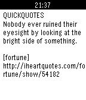

<!-- Generated by scripts/update_app_directory.py: do not edit by hand -->
[← All Pebble Developers](../developers.md)

# virgc

*1 app · Last updated 2026-10-11 · [About these lists](../about-app-lists.md)*

Links: [Pebble App Store](https://apps.repebble.com/apps/dev/virgc_53747078f10c2eaccb0000ad) · [GitHub (virginiacook)](https://github.com/virginiacook)

<h2 class="app-name" id="app-537d57142859a8c5b900007c"><a href="https://apps.repebble.com/537d57142859a8c5b900007c">quickquotes</a> v1.0.0</h2>
<a class="app-source" href="https://github.com/virginiacook/quickquotes" title="Source code" data-search-exclude>View source</a>

App

Released 2014-05-22 Updated 2014-05-22

Runs on: Time 2, Pebble 2 Duo, Pebble 2, Time, Classic

Displays a random quote for the user. Press the middle button to randomize. Quotes provided by the iheartquotes api.

