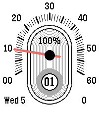
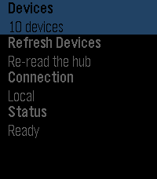

<!-- Generated by scripts/update_app_directory.py: do not edit by hand -->
[← All Pebble Developers](../developers.md)

# vision9074

*2 watchfaces and 1 app · Last updated 2026-10-11 · [About these lists](../about-app-lists.md)*

Links: [Pebble App Store](https://apps.repebble.com/apps/dev/vision9074_e7a26c7cc7610e75672e26e7) · [GitHub (Vision9074)](https://github.com/Vision9074)

<button type="button" data-filter="all" aria-pressed="true">All 3</button><button type="button" data-filter="watchface" aria-pressed="false">Watchfaces 2</button><button type="button" data-filter="watchapp" aria-pressed="false">Apps 1</button>

<label class="dev-sort">Sort by <select><option value="updated">Recently updated</option><option value="released">Newest release</option><option value="title">A–Z</option></select></label>

<h2 class="app-name" id="app-b5a83c82762942b7904cda3b"><a href="https://apps.repebble.com/b5a83c82762942b7904cda3b">Timeline Retrograde</a> v1.2.0</h2>
<a class="app-source" href="https://github.com/Vision9074/pebble-watchface-timeline-retrograde" title="Source code" data-search-exclude>View source</a>

Watchface

No licence Released 2026-08-05 Updated 2026-08-15

Runs on: Time 2, Pebble 2 Duo, Pebble 2, Time, Classic

Inspired by the Xeric Timeline Retrograde Automatic watches. Has predefined color options from their watches. Supports all rectangular Pebbles!

<h2 class="app-name" id="app-41c511043e0745108f3e2696"><a href="https://apps.repebble.com/41c511043e0745108f3e2696">Retroscope Jump Hour</a> v1.1.0</h2>
<a class="app-source" href="https://github.com/Vision9074/pebble-watchface-retroscope" title="Source code" data-search-exclude>View source</a>

Watchface

No licence Released 2026-08-05 Updated 2026-08-15

Runs on: Time 2, Pebble 2 Duo, Pebble 2, Time, Classic

Inspired by the Xeric Retrograde Jump Hour watches. Has predefined color options from their watches. Supports all rectangular Pebble watches!

<h2 class="app-name" id="app-5090015e5ff24c0c9f46af74"><a href="https://apps.repebble.com/5090015e5ff24c0c9f46af74">Hubitat Control</a> v1.1.0</h2>
<a class="app-source" href="https://github.com/Vision9074/pebble-app-hubitat-control" title="Source code" data-search-exclude>View source</a>

App

No licence Released 2026-08-12 Updated 2026-08-12

Runs on: Round 2, Time 2, Pebble 2 Duo, Pebble 2, Time Round, Time, Classic

Control your Hubitat home from your wrist. A Pebble watch app for lights, dimmers, speakers, locks, garage doors, shades, and sensors, talking to your hub through its built-in Maker API app — over…

