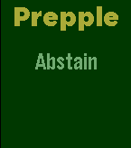

<!-- Generated by scripts/update_app_directory.py: do not edit by hand -->
[← All Pebble Developers](../developers.md)

# Vivek Vidyasagaran

*1 app · Last updated 2026-10-11 · [About these lists](../about-app-lists.md)*

Links: [Pebble App Store](https://apps.repebble.com/apps/dev/vivek-vidyasagaran_562bbf7b7c45cb47190000a5) · [GitHub (Vivek-sagar)](https://github.com/Vivek-sagar)

<h2 class="app-name" id="app-562d0711b56e5d1c570000b0"><a href="https://apps.repebble.com/562d0711b56e5d1c570000b0">Prepple</a> v1.0</h2>
<a class="app-source" href="https://github.com/Vivek-sagar/Prepple.git" title="Source code" data-search-exclude>View source</a>

App

No licence Released 2015-10-25 Updated 2015-10-25

Runs on: Time 2, Time

A handy little flash cards app that helps you prep for your GRE exam

