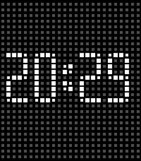

<!-- Generated by scripts/update_app_directory.py: do not edit by hand -->
[← All Pebble Developers](../developers.md)

# Vladislav &\#x27;midlneedle&\#x27; Iv

*1 watchface · Last updated 2026-10-12 · [About these lists](../about-app-lists.md)*

Links: [Rebble App Store](https://apps.rebble.io/en_US/developer/6914b85a1726d10009f9e745/1) · [GitHub (midlneedle-stack)](https://github.com/midlneedle-stack) · [Website (x.com)](https://x.com/midlneedle)

<h2 class="app-name" id="app-6914dc39a0d99d0009ff09f2"><a href="https://apps.rebble.io/en_US/application/6914dc39a0d99d0009ff09f2">General Magic</a> v1.5</h2>
<a class="app-source" href="https://github.com/midlneedle-stack/General_Magic_pebble_watchface" title="Source code" data-search-exclude>View source</a>

Watchface · <a href="https://forum.rebble.io/t/731" title="Discuss this app on the Rebble forum" data-search-exclude>Forum thread</a>

Released 2025-11-12 Updated 2026-03-02 Rebble App Store

Runs on: Round 2, Time 2, Pebble 2 Duo, Pebble 2, Time Round, Time, Classic

• Supports 12/24-hour time • Light and dark themes • Subtle artifact animation on launch • Optional hourly chime — a gentle nudge throughout the day Clean layout. Simple feel. Just enough personality.

