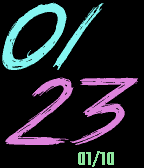

<!-- Generated by scripts/update_app_directory.py: do not edit by hand -->
[← All Pebble Developers](../developers.md)

# VN Pebble Dev

*1 watchface · Last updated 2026-10-12 · [About these lists](../about-app-lists.md)*

Links: [Pebble App Store](https://apps.repebble.com/apps/dev/vn-pebble-dev_56c84ed97c9161bdaa00002a) · [GitHub (samcarton)](https://github.com/samcarton) · [Website (facebook.com)](https://www.facebook.com/vnpebble/)

<h2 class="app-name" id="app-57ee926944581e90d40000d5"><a href="https://apps.repebble.com/57ee926944581e90d40000d5">Miami Nights Extra</a> v2.1</h2>
<a class="app-source" href="https://github.com/samcarton/miami-nights-pebble" title="Source code" data-search-exclude>View source</a>

Watchface

Released 2016-09-30 Updated 2016-10-01

Runs on: Time 2, Time

A simple yet striking large-font colored watchface for Pebble Time. Original by Miami Nights watchface of Sam Carton. Large font is True Lies by Jonathan S. Harris. - Date format configurable to…

