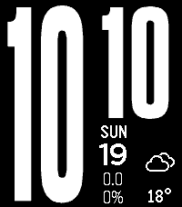
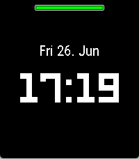

<!-- Generated by scripts/update_app_directory.py: do not edit by hand -->
[← All Pebble Developers](../developers.md)

# volksen

*3 watchfaces · Last updated 2026-10-11 · [About these lists](../about-app-lists.md)*

Links: [Pebble App Store](https://apps.repebble.com/apps/dev/volksen_2d30d3eefc7e77d201cb94ca) · [GitHub (volksen)](https://github.com/volksen)

<button type="button" data-filter="all" aria-pressed="true">All 3</button><button type="button" data-filter="watchface" aria-pressed="false">Watchfaces 3</button><button type="button" data-filter="watchapp" aria-pressed="false" disabled>Apps 0</button>

<label class="dev-sort">Sort by <select><option value="updated">Recently updated</option><option value="released">Newest release</option><option value="title">A–Z</option></select></label>

<h2 class="app-name" id="app-b655ae247e9b47ea8e7166e8"><a href="https://apps.repebble.com/b655ae247e9b47ea8e7166e8">A Rainy Face</a> v0.0.4</h2>
<a class="app-source" href="https://github.com/volksen/a_rainy_face" title="Source code" data-search-exclude>View source</a>

Watchface

Released 2026-06-24 Updated 2026-09-04

Runs on: Round 2, Time 2

Simple watchface with weather info from openmeteo, especially precipitation

<h2 class="app-name" id="app-bf5a0ce2cf624ec7af26b3a4"><a href="https://apps.repebble.com/bf5a0ce2cf624ec7af26b3a4">rainy phoenix</a> v0.2.0</h2>
<a class="app-source" href="https://github.com/volksen/rainy-phoenix" title="Source code" data-search-exclude>View source</a>

Watchface

Released 2026-07-19 Updated 2026-08-09

Runs on: Round 2, Time 2, Pebble 2 Duo, Pebble 2, Time Round, Time, Classic

Fork of the awesome phoenix big by astosia with rain amount and probability instead of steps and battery. I also removed many options, which i did not need. The watchface is still BETA!

<h2 class="app-name" id="app-bb2375458f8a4f259ed563a8"><a href="https://apps.repebble.com/bb2375458f8a4f259ed563a8">rainy face</a> v0.8.0</h2>
<a class="app-source" href="https://github.com/volksen/c_rainy_face" title="Source code" data-search-exclude>View source</a>

Watchface

Released 2026-06-25 Updated 2026-08-06

Runs on: Round 2, Time 2

a simple watchface with weather and rain data from openmeteo

