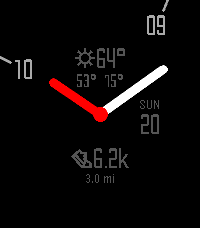
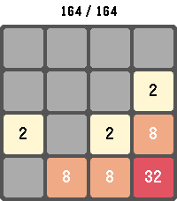

<!-- Generated by scripts/update_app_directory.py: do not edit by hand -->
[← All Pebble Developers](../developers.md)

# vorsk

*1 watchface and 1 app · Last updated 2026-10-11 · [About these lists](../about-app-lists.md)*

Links: [Pebble App Store](https://apps.repebble.com/apps/dev/vorsk_5494f31f210576e99c00005a) · [GitHub (lanrat)](https://github.com/lanrat) · [Website (lanrat.com)](https://lanrat.com/projects/minimalin-reborn/)

<button type="button" data-filter="all" aria-pressed="true">All 2</button><button type="button" data-filter="watchface" aria-pressed="false">Watchfaces 1</button><button type="button" data-filter="watchapp" aria-pressed="false">Apps 1</button>

<label class="dev-sort">Sort by <select><option value="updated">Recently updated</option><option value="released">Newest release</option><option value="title">A–Z</option></select></label>

<h2 class="app-name" id="app-63792649c6c24a000a815e70"><a href="https://apps.repebble.com/63792649c6c24a000a815e70">Minimalin Reborn</a> v2.12.0</h2>
<a class="app-source" href="https://github.com/lanrat/minimalin-reborn" title="Source code" data-search-exclude>View source</a>

Watchface · <a href="https://forum.rebble.io/t/760" title="Discuss this app on the Rebble forum" data-search-exclude>Forum thread</a>

Released 2022-11-19 Updated 2026-09-17

Runs on: Round 2, Time 2, Pebble 2 Duo, Pebble 2, Time Round, Time, Classic

Minimalin is a fully customizable watchface that blends analog and digital for a modern and elegant look.Minimalin uses Nupe, a custom font with numbers and icons, optimized with bitmap mapping to…

<h2 class="app-name" id="app-6df87b64b7174448a065ef54"><a href="https://apps.repebble.com/6df87b64b7174448a065ef54">2048 Touch</a> v1.2.0</h2>
<a class="app-source" href="https://github.com/lanrat/pebble-2048-touch" title="Source code" data-search-exclude>View source</a>

App · <a href="https://forum.rebble.io/t/973" title="Discuss this app on the Rebble forum" data-search-exclude>Forum thread</a>

Released 2026-05-14 Updated 2026-05-24

Runs on: Round 2, Time 2, Pebble 2 Duo, Pebble 2, Time Round, Time, Classic

Play the classic 2048 sliding-tile puzzle on your Pebble. Combine matching numbered tiles to add them together and work your way up to the 2048 tile — and beyond. Swipe to move on touch-capable…

