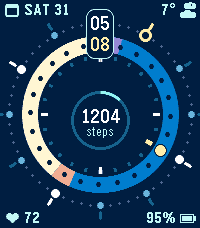
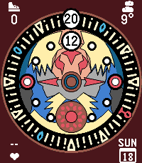

<!-- Generated by scripts/update_app_directory.py: do not edit by hand -->
[← All Pebble Developers](../developers.md)

# Vortex375

*2 watchfaces · Last updated 2026-11-09 · [About these lists](../about-app-lists.md)*

Links: [Pebble App Store](https://apps.repebble.com/apps/dev/vortex375_816691a09977084fa9effe30) · [GitHub (Vortex375)](https://github.com/Vortex375)

<button type="button" data-filter="all" aria-pressed="true">All 2</button><button type="button" data-filter="watchface" aria-pressed="false">Watchfaces 2</button><button type="button" data-filter="watchapp" aria-pressed="false" disabled>Apps 0</button>

<label class="dev-sort">Sort by <select><option value="updated">Recently updated</option><option value="released">Newest release</option><option value="title">A–Z</option></select></label>

<h2 class="app-name" id="app-6bcf5df2349e4ff19ca9a4a5"><a href="https://apps.repebble.com/6bcf5df2349e4ff19ca9a4a5">Tellura</a> v1.1.0</h2>
<a class="app-source" href="https://github.com/Vortex375/pebble-watchfaces/tree/main/tellura" title="Source code" data-search-exclude>View source</a>

Watchface

MIT Released 2026-10-31 Updated 2026-11-01

Runs on: Time 2

Tellura shows the time on two turning rings: minutes on the outer ring, hours on the inner one. Both turn clockwise. Read the current minute and hour at the top, or read the yellow markers like…

<h2 class="app-name" id="app-f00a753025704746a790a1ed"><a href="https://apps.repebble.com/f00a753025704746a790a1ed">Clock Town Clock</a> v1.2.0</h2>
<a class="app-source" href="https://github.com/Vortex375/clocktown-clock" title="Source code" data-search-exclude>View source</a>

Watchface

MIT Released 2026-10-18 Updated 2026-11-01

Runs on: Time 2

Pebble Time 2 watch face inspired by the Clock Tower design from The Legendof Zelda - Majora&#x27;s Mask. Supports displaying the time in digital format and the four corners are configurable to display…

