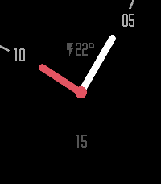

<!-- Generated by scripts/update_app_directory.py: do not edit by hand -->
[← All Pebble Developers](../developers.md)

# Vrabbers

*1 watchface · Last updated 2026-10-11 · [About these lists](../about-app-lists.md)*

Links: [Rebble App Store](https://apps.rebble.io/en_US/developer/67effc03fb177b00084b0aa5/1) · [GitHub (Vrabbers)](https://github.com/Vrabbers)

<h2 class="app-name" id="app-68013ba9ef119e0009664826"><a href="https://apps.rebble.io/en_US/application/68013ba9ef119e0009664826">Minimalin Again</a> v3.2</h2>
<a class="app-source" href="https://github.com/Vrabbers/minimalin-again" title="Source code" data-search-exclude>View source</a>

Watchface

MIT Released 2025-04-17 Updated 2025-04-24 Rebble App Store

Runs on: Round 2, Time 2, Pebble 2 Duo, Pebble 2, Time Round, Time, Classic

Minimalin Again is a fully customizable watchface that blends analog and digital for a simple, modern and elegant look, based on the original Minimalin watchface and the Minimalin Reborn fork. *…

