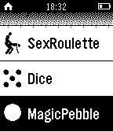

<!-- Generated by scripts/update_app_directory.py: do not edit by hand -->
[← All Pebble Developers](../developers.md)

# vvzvlad

*2 apps · Last updated 2026-10-11 · [About these lists](../about-app-lists.md)*

Links: [Pebble App Store](https://apps.repebble.com/apps/dev/vvzvlad_52a92f2cc0ca93629100000d) · [GitHub (vvzvlad)](https://github.com/vvzvlad) · [Website (7del.net)](http://7del.net)

<button type="button" data-filter="all" aria-pressed="true">All 2</button><button type="button" data-filter="watchface" aria-pressed="false" disabled>Watchfaces 0</button><button type="button" data-filter="watchapp" aria-pressed="false">Apps 2</button>

<label class="dev-sort">Sort by <select><option value="updated">Recently updated</option><option value="released">Newest release</option><option value="title">A–Z</option></select></label>

<h2 class="app-name" id="app-52b3043ecd41834a620000ef"><a href="https://apps.repebble.com/52b3043ecd41834a620000ef">Magic Pebble RUS/EN</a> v1.1</h2>
<a class="app-source" href="https://github.com/vvzvlad/Pebble-MagicPebble" title="Source code" data-search-exclude>View source</a>

App

Released 2013-12-19 Updated 2014-12-30

Runs on: Time 2, Pebble 2 Duo, Pebble 2, Time, Classic

Turn your clocks in the magic ball, answering questions Превратите ваши часы в шарик с ответами. Получите ответы на волнующие вас вопросы

<h2 class="app-name" id="app-52b301a2cd4183347d0000eb"><a href="https://apps.repebble.com/52b301a2cd4183347d0000eb">Dice</a> v1.1</h2>
<a class="app-source" href="https://github.com/vvzvlad/Pebble-Dice" title="Source code" data-search-exclude>View source</a>

App

Released 2013-12-19 Updated 2014-12-30

Runs on: Time 2, Pebble 2 Duo, Pebble 2, Time, Classic

Dice your watch. Shake the clock to roll a die!

