<!-- Generated by scripts/update_app_directory.py: do not edit by hand -->
[← All Pebble Developers](../developers.md)

# WA1OUI

*13 watchfaces · Last updated 2026-10-11 · [About these lists](../about-app-lists.md)*

Links: [Rebble App Store](https://apps.rebble.io/en_US/developer/52acd9c431a5fa984900002e/1) · [GitHub (DHKaplan)](https://github.com/DHKaplan)

<button type="button" data-filter="all" aria-pressed="true">All 13</button><button type="button" data-filter="watchface" aria-pressed="false">Watchfaces 13</button><button type="button" data-filter="watchapp" aria-pressed="false" disabled>Apps 0</button>

<label class="dev-sort">Sort by <select><option value="updated">Recently updated</option><option value="released">Newest release</option><option value="title">A–Z</option></select></label>

<a class="app-shot" href="https://apps.rebble.io/en_US/application/5880a4a595ce5bbf140000bd" data-search-exclude>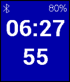</a>

<h2 class="app-name" id="app-5880a4a595ce5bbf140000bd"><a href="https://apps.rebble.io/en_US/application/5880a4a595ce5bbf140000bd">Mainly Seconds</a> v1.0</h2>
<a class="app-source" href="https://github.com/DHKaplan/Mainly_Seconds/blob/master/Mainly_Seconds-V1.0.zip" title="Source code" data-search-exclude>View source</a>

Watchface

No licence Released 2017-01-19 Updated 2017-01-19 Rebble App Store

Runs on: Round 2, Time 2, Pebble 2 Duo, Pebble 2, Time Round, Time, Classic

Mainly seconds shows... well mainly seconds. There is a battery indicator, BT indicator and the hours and minutes, but the seconds are front and center. Be aware this will reduce battery life if…

<h2 class="app-name" id="app-587bf9e92ee4312381000861"><a href="https://apps.rebble.io/en_US/application/587bf9e92ee4312381000861">Time and Steps</a> v1.0</h2>
<a class="app-source" href="https://github.com/DHKaplan/Time_And_Steps/blob/master/Time_And_Steps-V1.1.zip" title="Source code" data-search-exclude>View source</a>

Watchface

No licence Released 2017-01-15 Updated 2017-01-15 Rebble App Store

Runs on: Round 2, Time 2, Pebble 2 Duo, Pebble 2, Time Round, Time

This is a simple watchface that shows day, date and time of day with Location and Temperature. Steps walked as well as distance in miles and kilometers are also shown.

<a class="app-shot" href="https://apps.rebble.io/en_US/application/5674f44fa817159fc8000094" data-search-exclude>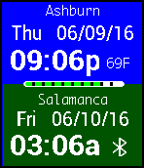</a>

<h2 class="app-name" id="app-5674f44fa817159fc8000094"><a href="https://apps.rebble.io/en_US/application/5674f44fa817159fc8000094">Dual Time Zone</a> v4.3</h2>
<a class="app-source" href="https://github.com/DHKaplan/DualTZ/blob/master/DualTZ-V4.3.zip" title="Source code" data-search-exclude>View source</a>

Watchface

No licence Released 2015-12-19 Updated 2016-11-18 Rebble App Store

Runs on: Round 2, Time 2, Pebble 2 Duo, Pebble 2, Time Round, Time, Classic

Dual Time Zone shows your local time, temperature and location on top, and a custom time zone on the bottom. All colors are configurable as is a Celsius or Fahrenheit temperature. The battery…

<a class="app-shot" href="https://apps.rebble.io/en_US/application/5344540189b0ae14d80003b9" data-search-exclude>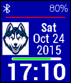</a>

<h2 class="app-name" id="app-5344540189b0ae14d80003b9"><a href="https://apps.rebble.io/en_US/application/5344540189b0ae14d80003b9">UCONN Logo</a> v7.2</h2>
<a class="app-source" href="https://github.com/DHKaplan/UCONN/blob/master/UCONN-V7.2.zip" title="Source code" data-search-exclude>View source</a>

Watchface

No licence Released 2014-04-08 Updated 2016-10-18 Rebble App Store

Runs on: Round 2, Time 2, Pebble 2 Duo, Pebble 2, Time Round, Time, Classic

Here&#x27;s the UCONN Huskies&#x27; Logo. A Bluetooth indicator (and vibration when connectivity is lost) as well as battery percentage and a battery percentage bar (showing green for OK, Red for 20% or…

<a class="app-shot" href="https://apps.rebble.io/en_US/application/52ace5c831a5fa0719000037" data-search-exclude>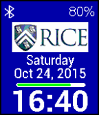</a>

<h2 class="app-name" id="app-52ace5c831a5fa0719000037"><a href="https://apps.rebble.io/en_US/application/52ace5c831a5fa0719000037">Rice University Logo</a> v7.2</h2>
<a class="app-source" href="https://github.com/DHKaplan/RICE/blob/master/Rice-V7.2.zip" title="Source code" data-search-exclude>View source</a>

Watchface

No licence Released 2013-12-14 Updated 2016-10-18 Rebble App Store

Runs on: Round 2, Time 2, Pebble 2 Duo, Pebble 2, Time Round, Time, Classic

Here&#x27;s the Rice University Logo. A Bluetooth indicator (and optional vibration when connectivity is lost) as well as battery percentage and a battery percentage bar (showing green for OK, Red for…

<a class="app-shot" href="https://apps.rebble.io/en_US/application/53445351a5524e5091000384" data-search-exclude>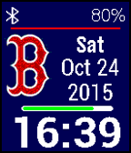</a>

<h2 class="app-name" id="app-53445351a5524e5091000384"><a href="https://apps.rebble.io/en_US/application/53445351a5524e5091000384">Red Sox Logo</a> v7.2</h2>
<a class="app-source" href="https://github.com/DHKaplan/Red-Sox/blob/master/Red-Sox-V7.2.zip" title="Source code" data-search-exclude>View source</a>

Watchface

No licence Released 2014-04-08 Updated 2016-10-18 Rebble App Store

Runs on: Round 2, Time 2, Pebble 2 Duo, Pebble 2, Time Round, Time, Classic

Here&#x27;s the Boston Red Sox Logo. A Bluetooth indicator (and optional vibration when connectivity is lost) as well as battery percentage and a battery percentage bar (showing green for OK, Red for…

<a class="app-shot" href="https://apps.rebble.io/en_US/application/5587362f49c1d163e2000050" data-search-exclude>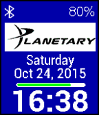</a>

<h2 class="app-name" id="app-5587362f49c1d163e2000050"><a href="https://apps.rebble.io/en_US/application/5587362f49c1d163e2000050">Planetary Society Logo</a> v4.2</h2>
<a class="app-source" href="https://github.com/DHKaplan/Planetary/blob/master/Planetary-V4.2.zip" title="Source code" data-search-exclude>View source</a>

Watchface

No licence Released 2015-06-21 Updated 2016-10-18 Rebble App Store

Runs on: Round 2, Time 2, Pebble 2 Duo, Pebble 2, Time Round, Time, Classic

Here&#x27;s the Planetary Society Logo. A Bluetooth indicator (and optional vibration when connectivity is lost) as well as battery percentage and a battery percentage bar (showing green for OK, Red…

<a class="app-shot" href="https://apps.rebble.io/en_US/application/56119a271cdcfc9faa000030" data-search-exclude>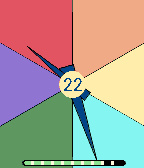</a>

<h2 class="app-name" id="app-56119a271cdcfc9faa000030"><a href="https://apps.rebble.io/en_US/application/56119a271cdcfc9faa000030">Pinwheel-II</a> v3.1</h2>
<a class="app-source" href="https://github.com/DHKaplan/Pinwheel-II/blob/master/Pinwheel-II-V3.1.zip" title="Source code" data-search-exclude>View source</a>

Watchface

No licence Released 2015-10-04 Updated 2016-10-18 Rebble App Store

Runs on: Round 2, Time 2, Time Round, Time

Pinwheel-II is a colorful watch face that changes every minute, but a bit different than it&#x27;s older brother, Pinwheel. Day of the month is in the center circle, which is red if Bluetooth is lost…

<a class="app-shot" href="https://apps.rebble.io/en_US/application/55e267e83ea1fbe87b0000ea" data-search-exclude>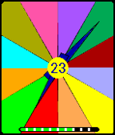</a>

<h2 class="app-name" id="app-55e267e83ea1fbe87b0000ea"><a href="https://apps.rebble.io/en_US/application/55e267e83ea1fbe87b0000ea">Pinwheel</a> v3.1</h2>
<a class="app-source" href="https://github.com/DHKaplan/Pinwheel/blob/master/Pinwheel-V3.1.zip" title="Source code" data-search-exclude>View source</a>

Watchface

No licence Released 2015-08-30 Updated 2016-10-18 Rebble App Store

Runs on: Round 2, Time 2, Time Round, Time

Pinwheel is a colorful watch face that changes every minute. Day of the month is in the center circle, which is red if Bluetooth is lost. Battery level on a bottom graph shows red when 20% or…

<a class="app-shot" href="https://apps.rebble.io/en_US/application/5561bf9634f3a5374b000058" data-search-exclude>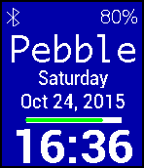</a>

<h2 class="app-name" id="app-5561bf9634f3a5374b000058"><a href="https://apps.rebble.io/en_US/application/5561bf9634f3a5374b000058">Personalize!</a> v5.2</h2>
<a class="app-source" href="https://github.com/DHKaplan/Personalize/blob/master/Personalize-V5.2.zip" title="Source code" data-search-exclude>View source</a>

Watchface

No licence Released 2015-05-24 Updated 2016-10-18 Rebble App Store

Runs on: Round 2, Time 2, Pebble 2 Duo, Pebble 2, Time Round, Time, Classic

Personalize! Lets you add a line of text (up to 11 characters long) with a configuration page to your watchface to show the world what&#x27;s important to you. It can be the name of someone or…

<a class="app-shot" href="https://apps.rebble.io/en_US/application/57915144842428d20000028c" data-search-exclude>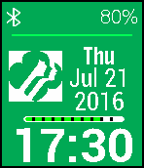</a>

<h2 class="app-name" id="app-57915144842428d20000028c"><a href="https://apps.rebble.io/en_US/application/57915144842428d20000028c">Girl Scout Logo</a> v2.2</h2>
<a class="app-source" href="https://github.com/DHKaplan/Girl-Scouts/blob/master/Girl-Scouts-V2.2.zip" title="Source code" data-search-exclude>View source</a>

Watchface

No licence Released 2016-07-21 Updated 2016-10-18 Rebble App Store

Runs on: Round 2, Time 2, Pebble 2 Duo, Pebble 2, Time Round, Time, Classic

Here&#x27;s the Girl Scout Logo. A Bluetooth indicator and battery percentage and a battery percentage bar (showing green for OK, Red for 20% or less, and blue for charging) are included. There is a…

<a class="app-shot" href="https://apps.rebble.io/en_US/application/5626c4dbc7810a1507000093" data-search-exclude>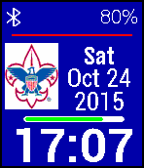</a>

<h2 class="app-name" id="app-5626c4dbc7810a1507000093"><a href="https://apps.rebble.io/en_US/application/5626c4dbc7810a1507000093">Boy Scout Logo</a> v4.2</h2>
<a class="app-source" href="https://github.com/DHKaplan/Boy-Scouts/blob/master/Boy-Scouts-V4.2.zip" title="Source code" data-search-exclude>View source</a>

Watchface

No licence Released 2015-10-20 Updated 2016-10-18 Rebble App Store

Runs on: Round 2, Time 2, Pebble 2 Duo, Pebble 2, Time Round, Time, Classic

Here&#x27;s the Boy Scout Logo. A Bluetooth indicator (and vibration when connectivity is lost) as well as battery percentage and a battery percentage bar (showing green for OK, Red for 20% or less…

<a class="app-shot" href="https://apps.rebble.io/en_US/application/52ace1ec19ff5001fc00001d" data-search-exclude>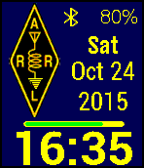</a>

<h2 class="app-name" id="app-52ace1ec19ff5001fc00001d"><a href="https://apps.rebble.io/en_US/application/52ace1ec19ff5001fc00001d">ARRL</a> v7.2</h2>
<a class="app-source" href="https://github.com/DHKaplan/ARRL/blob/master/ARRL-V7.2.zip" title="Source code" data-search-exclude>View source</a>

Watchface

No licence Released 2013-12-14 Updated 2016-10-18 Rebble App Store

Runs on: Round 2, Time 2, Pebble 2 Duo, Pebble 2, Time Round, Time, Classic

This is the Logo of the ARRL (American Radio Relay League) which is the US National organization for Ham (Amateur) Radio. A Bluetooth indicator (and optional vibration when connectivity is lost)…

