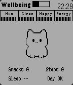

<!-- Generated by scripts/update_app_directory.py: do not edit by hand -->
[← All Pebble Developers](../developers.md)

# Walkerdeath

*1 app · Last updated 2026-10-11 · [About these lists](../about-app-lists.md)*

Links: [Pebble App Store](https://apps.repebble.com/apps/dev/walkerdeath_29e02d6aeb82b422cdf9b7ba) · [GitHub (walkerdeath)](https://github.com/walkerdeath)

<h2 class="app-name" id="app-399b6a126b314717818cbcee"><a href="https://apps.repebble.com/399b6a126b314717818cbcee">Pebblegotchi</a> v1.0</h2>
<a class="app-source" href="https://github.com/walkerdeath/Pebblegotchi" title="Source code" data-search-exclude>View source</a>

App

Released 2026-04-06 Updated 2026-04-06

Runs on: Time 2, Pebble 2 Duo, Pebble 2, Time

Feed, clean, play, and meditate with a tiny wrist pet. A daily ritual that revives pixel‑era nostalgia and turns small habits into a warm, retro moment.

