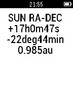

<!-- Generated by scripts/update_app_directory.py: do not edit by hand -->
[← All Pebble Developers](../developers.md)

# walteregli

*1 app · Last updated 2026-10-12 · [About these lists](../about-app-lists.md)*

Links: [Pebble App Store](https://apps.repebble.com/apps/dev/walteregli_53fc5c7df4342cf934000046)

<h2 class="app-name" id="app-56570b62cae23b950f000049"><a href="https://apps.repebble.com/56570b62cae23b950f000049">Moon Ascending Descending</a> v1.9</h2>
<a class="app-source" href="https://cloudpebble.net/ide/project/89386#" title="Source code" data-search-exclude>View source</a>

App

Released 2015-11-26 Updated 2016-04-15

Runs on: Round 2, Time 2, Pebble 2 Duo, Pebble 2, Time Round, Time, Classic

Moon Ascending Descending Slope. All the calculation is done locally in pebble ( no link to internet is needed). The moon declination slope will shown as a real calculated graph in pebble by…

