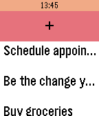

<!-- Generated by scripts/update_app_directory.py: do not edit by hand -->
[← All Pebble Developers](../developers.md)

# Warren Fernandes

*1 app · Last updated 2026-10-11 · [About these lists](../about-app-lists.md)*

Links: [Pebble App Store](https://apps.repebble.com/apps/dev/warren-fernandes_56a5aa16ed368bdaa3000012) · [GitHub (wfernandes)](https://github.com/wfernandes)

<h2 class="app-name" id="app-5830b6418c7fff66e1000061"><a href="https://apps.repebble.com/5830b6418c7fff66e1000061">Scripple</a> v1.1</h2>
<a class="app-source" href="https://github.com/wfernandes/scripple" title="Source code" data-search-exclude>View source</a>

App

Released 2016-11-19 Updated 2016-11-21

Runs on: Round 2, Time 2, Time Round, Time

A pebble app the scribes spontaneous thoughts, ideas and yes, also to-do items. It uses the dictation service and can store up to ten items.

