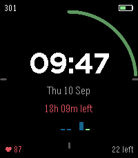
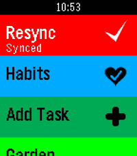
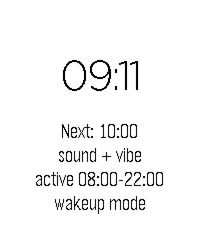
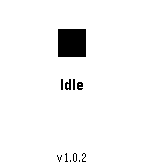

<!-- Generated by scripts/update_app_directory.py: do not edit by hand -->
[← All Pebble Developers](../developers.md)

# Webstas “Webstas”

*1 watchface and 5 apps · Last updated 2026-10-11 · [About these lists](../about-app-lists.md)*

Links: [Pebble App Store](https://apps.repebble.com/apps/dev/webstas-webstas_990614069b2a89f2e0c44e8b) · [GitHub (BigWebstas)](https://github.com/BigWebstas)

<button type="button" data-filter="all" aria-pressed="true">All 6</button><button type="button" data-filter="watchface" aria-pressed="false">Watchfaces 1</button><button type="button" data-filter="watchapp" aria-pressed="false">Apps 5</button>

<label class="dev-sort">Sort by <select><option value="updated">Recently updated</option><option value="released">Newest release</option><option value="title">A–Z</option></select></label>

<h2 class="app-name" id="app-a3f6e4b8c40a44f8a743c296"><a href="https://apps.repebble.com/a3f6e4b8c40a44f8a743c296">Super Productivity Watch Face</a> v0.1.0</h2>
<a class="app-source" href="https://github.com/BigWebstas/PebbleSuperProductivityFace" title="Source code" data-search-exclude>View source</a>

Watchface

GPL-3.0 Released 2026-09-10 Updated 2026-09-10

Runs on: Round 2, Time 2, Pebble 2 Duo, Pebble 2, Time Round, Time, Classic

Super Productivity companion watchface

<h2 class="app-name" id="app-54adbee8647b4f548f339063"><a href="https://apps.repebble.com/54adbee8647b4f548f339063">xDrip CGM</a> v1.0.0</h2>
<a class="app-source" href="https://github.com/BigWebstas/PebbleXDrip" title="Source code" data-search-exclude>View source</a>

App

No licence Released 2026-09-09 Updated 2026-09-09

Runs on: Round 2, Time 2, Pebble 2 Duo, Pebble 2, Time Round, Time

A Pebble quick-launch app that shows your xDrip+ CGM data — number, trend, delta and a 2-hour graph. It is not a watchface, so you can run any watchface and still get a glucose glance on demand…

<h2 class="app-name" id="app-5bb5f299dfbb4455aa21a3fb"><a href="https://apps.repebble.com/5bb5f299dfbb4455aa21a3fb">Super Productivity</a> v0.6.48</h2>
<a class="app-source" href="https://github.com/BigWebstas/PebbleSuperProductivity" title="Source code" data-search-exclude>View source</a>

App · <a href="https://forum.rebble.io/t/1338" title="Discuss this app on the Rebble forum" data-search-exclude>Forum thread</a>

GPL-3.0 Released 2026-08-25 Updated 2026-09-09

Runs on: Round 2, Time 2, Pebble 2 Duo, Pebble 2, Time Round, Time, Classic

A PebbleOS watchapp that shows your active tasks from Super Productivity — optionally grouped by project — and lets you mark them done, track time, dictate new tasks by voice, and track habits…

<h2 class="app-name" id="app-e179bf68b6924b09858dd59d"><a href="https://apps.repebble.com/e179bf68b6924b09858dd59d">Hourly Chime</a> v1.4.0</h2>
<a class="app-source" href="https://github.com/BigWebstas/PebbleHourlyChime" title="Source code" data-search-exclude>View source</a>

App

No licence Released 2026-09-09 Updated 2026-09-09

Runs on: Time 2, Pebble 2 Duo

A PebbleOS watchapp that chimes on the hour with the speaker and/or the vibration motor. Runs on Pebble Time 2 (emery) and Pebble 2 Duo (flint) — the two watches with a speaker.

<h2 class="app-name" id="app-8617ec913a584ba4ad22f4d6"><a href="https://apps.repebble.com/8617ec913a584ba4ad22f4d6">Cardia</a> v1.2.0</h2>
<a class="app-source" href="https://github.com/BigWebstas/PebbleCardia" title="Source code" data-search-exclude>View source</a>

App

No licence Released 2026-09-09 Updated 2026-09-09

Runs on: Round 2, Time 2

A PebbleOS watchapp that watches your heart rate more closely than the system does by default and flags three things: sustained high rate, sustained low rate, and irregularly-irregular rhythm (the…

<h2 class="app-name" id="app-afcad232b3cd40398cbb0c04"><a href="https://apps.repebble.com/afcad232b3cd40398cbb0c04">PebbleRecorder</a> v1.0.3</h2>
<a class="app-source" href="https://github.com/BigWebstas/PebbleRecorder" title="Source code" data-search-exclude>View source</a>

App

GPL-3.0 Released 2026-08-25 Updated 2026-08-29

Runs on: Round 2, Time 2, Pebble 2 Duo, Pebble 2, Time Round, Time, Classic

Turn your Pebble watch into a remote start/stop trigger for audio recording on your phone. Press a button on the watch, and a companion Android app records straight to a folder you choose — no…

