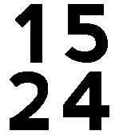

<!-- Generated by scripts/update_app_directory.py: do not edit by hand -->
[← All Pebble Developers](../developers.md)

# wedwabbit

*3 watchfaces · Last updated 2026-10-11 · [About these lists](../about-app-lists.md)*

Links: [Pebble App Store](https://apps.repebble.com/apps/dev/wedwabbit_52f01d5093a087ad2500041d) · [GitHub (wedwabbit)](https://github.com/wedwabbit)

<button type="button" data-filter="all" aria-pressed="true">All 3</button><button type="button" data-filter="watchface" aria-pressed="false">Watchfaces 3</button><button type="button" data-filter="watchapp" aria-pressed="false" disabled>Apps 0</button>

<label class="dev-sort">Sort by <select><option value="updated">Recently updated</option><option value="released">Newest release</option><option value="title">A–Z</option></select></label>

<h2 class="app-name" id="app-5660e85b15c22b9d6300008c"><a href="https://apps.repebble.com/5660e85b15c22b9d6300008c">Big Time+Date Colour</a> v1.7</h2>
<a class="app-source" href="https://github.com/wedwabbit/Big-Time-DateColour" title="Source code" data-search-exclude>View source</a>

Watchface

Released 2015-12-04 Updated 2016-01-06

Runs on: Time 2, Time

A colour version of Big Date+Time. Configuration page allows you to choose font (Original Big Time, Big Again, SquareFace, CST, Alpha Slab, Digital Thin, Digital Thick), separate foreground and…

<h2 class="app-name" id="app-565697117ffb06b5d900004c"><a href="https://apps.repebble.com/565697117ffb06b5d900004c">Big Time+Date Reverse</a> v1.1</h2>
<a class="app-source" href="https://github.com/wedwabbit/Big-Time-DateReverse" title="Source code" data-search-exclude>View source</a>

Watchface

Released 2015-11-26 Updated 2015-11-30

Runs on: Round 2, Time 2, Pebble 2 Duo, Pebble 2, Time Round, Time, Classic

A reversed (black on white) version of Big Time that displays both the date and time. Shake or tap to display the date for 1 second. Date on the top, month on the bottom. Search for Big Date+Time…

<h2 class="app-name" id="app-56440d92b2bae2732e00001a"><a href="https://apps.repebble.com/56440d92b2bae2732e00001a">Big Time+Date</a> v6.2</h2>
<a class="app-source" href="https://github.com/wedwabbit/Big-Time-Date" title="Source code" data-search-exclude>View source</a>

Watchface

Released 2015-11-12 Updated 2015-11-30

Runs on: Round 2, Time 2, Pebble 2 Duo, Pebble 2, Time Round, Time, Classic

A version of Big Time that displays both the date and time. Shake or tap to display the date for 1 second. Date on the top, month on the bottom. Search for Big Time+Date Reverse for a black on…

