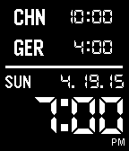

<!-- Generated by scripts/update_app_directory.py: do not edit by hand -->
[← All Pebble Developers](../developers.md)

# Weilong Zhang

*1 watchface · Last updated 2026-10-12 · [About these lists](../about-app-lists.md)*

Links: [Pebble App Store](https://apps.repebble.com/apps/dev/weilong-zhang_52f18848c4117252f9000905) · [GitHub (wz2218)](https://github.com/wz2218)

<h2 class="app-name" id="app-53657b1314acdb101d000074"><a href="https://apps.repebble.com/53657b1314acdb101d000074">Multi Timezone</a> v3.0</h2>
<a class="app-source" href="https://github.com/wz2218/multiTZ" title="Source code" data-search-exclude>View source</a>

Watchface

Released 2014-05-03 Updated 2025-12-01

Runs on: Time 2, Pebble 2 Duo, Pebble 2, Time, Classic

A simple multi-timezone watchface. Names and UTC offsets for time zones are configurable.

