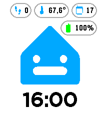

<!-- Generated by scripts/update_app_directory.py: do not edit by hand -->
[← All Pebble Developers](../developers.md)

# wendevlin

*1 watchface · Last updated 2026-10-12 · [About these lists](../about-app-lists.md)*

Links: [Pebble App Store](https://apps.repebble.com/apps/dev/wendevlin_dfc6609f546faff70ad5521b) · [GitHub (wendevlin)](https://github.com/wendevlin)

<h2 class="app-name" id="app-7ed76c8a20324151a9137ac5"><a href="https://apps.repebble.com/7ed76c8a20324151a9137ac5">Casita</a> v1.1.0</h2>
<a class="app-source" href="https://github.com/wendevlin/pebble-casita-watchface" title="Source code" data-search-exclude>View source</a>

Watchface

Released 2026-09-16 Updated 2026-09-17

Runs on: Round 2, Time 2

A cheerful Casita watchface with live badges for weather, steps, date, battery, and Home Assistant temperature — expressions change throughout the day.

