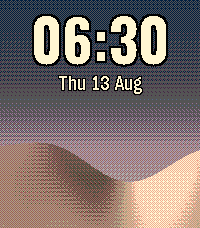

<!-- Generated by scripts/update_app_directory.py: do not edit by hand -->
[← All Pebble Developers](../developers.md)

# wheelybird

*1 watchface · Last updated 2026-10-12 · [About these lists](../about-app-lists.md)*

Links: [Pebble App Store](https://apps.repebble.com/apps/dev/wheelybird_b0e47815365a66ccde5932a9) · [GitHub (wheelybird)](https://github.com/wheelybird)

<h2 class="app-name" id="app-e7fce00841fe4486b16e9168"><a href="https://apps.repebble.com/e7fce00841fe4486b16e9168">Dunescape</a> v1.2</h2>
<a class="app-source" href="https://github.com/wheelybird/dunescape" title="Source code" data-search-exclude>View source</a>

Watchface

Released 2026-04-10 Updated 2026-08-14

Runs on: Round 2, Time 2, Pebble 2 Duo, Pebble 2, Time Round, Time, Classic

Dunescape — a living desert that follows the real sun and moon. The dunes are lit by the actual sun for your location. One face catches the light and the other falls into shadow, and through the…

