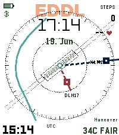
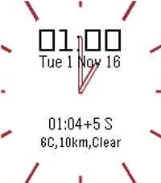

<!-- Generated by scripts/update_app_directory.py: do not edit by hand -->
[← All Pebble Developers](../developers.md)

# wiegand

*2 watchfaces and 1 app · Last updated 2026-10-12 · [About these lists](../about-app-lists.md)*

Links: [Pebble App Store](https://apps.repebble.com/apps/dev/wiegand_56353c069ac02bf83300000e) · [Rebble App Store](https://apps.rebble.io/en_US/developer/56353c069ac02bf83300000e/1) · [GitHub (chuckmoritzgg)](https://github.com/chuckmoritzgg) · [GitHub (moerunner)](https://github.com/moerunner) · [Website (paypal.com)](https://www.paypal.com/cgi-bin/webscr?cmd=_s-xclick&hosted_button_id=YNAK2AH7ZK4WQ)

<button type="button" data-filter="all" aria-pressed="true">All 3</button><button type="button" data-filter="watchface" aria-pressed="false">Watchfaces 2</button><button type="button" data-filter="watchapp" aria-pressed="false">Apps 1</button>

<label class="dev-sort">Sort by <select><option value="updated">Recently updated</option><option value="released">Newest release</option><option value="title">A–Z</option></select></label>

<h2 class="app-name" id="app-08a97783ae8947b092fbecfe"><a href="https://apps.repebble.com/08a97783ae8947b092fbecfe">ATC radar</a> v1.4</h2>
<a class="app-source" href="https://github.com/chuckmoritzgg/pebble-atc-radar" title="Source code" data-search-exclude>View source</a>

Watchface

No licence Released 2026-04-03 Updated 2026-06-27

Runs on: Round 2, Time 2

Clean aviation timekeeping: labeled hands represent analog time trackers. Battery, steps, and next event are flight strips and keep you heads-up. Pure radar aesthetic, zero clutter. Perfect for…

<a class="app-shot" href="https://apps.repebble.com/5b5c25bdb840489c921b4b23" data-search-exclude>No screenshot</a>

<h2 class="app-name" id="app-5b5c25bdb840489c921b4b23"><a href="https://apps.repebble.com/5b5c25bdb840489c921b4b23">🔦 torch color edition</a> v1.0</h2>
<a class="app-source" href="https://github.com/chuckmoritzgg/pebble-torch-color-edition" title="Source code" data-search-exclude>View source</a>

App

MIT Released 2026-06-06 Updated 2026-06-06

Runs on: Round 2, Time 2, Pebble 2 Duo, Pebble 2, Time Round, Time, Classic

Unfortunately dimming brightness is not possible but we can circle a few colors on PT2

<h2 class="app-name" id="app-5817e11621032e184e000017"><a href="https://apps.rebble.io/en_US/application/5817e11621032e184e000017">DB Pendel Bahn</a> v1.13</h2>
<a class="app-source" href="https://github.com/moerunner/DBPendelBahn" title="Source code" data-search-exclude>View source</a>

Watchface

Released 2016-11-01 Updated 2017-12-15 Rebble App Store

Runs on: Round 2, Time 2, Pebble 2 Duo, Pebble 2, Time Round, Time

public transportation watchface for germany / europe. webscraper for deutsche bahn website. Das Watchface überwacht eine Bahnverbindung inklusive Verspätung und ändert Mittags(konfigurierbar) die…

