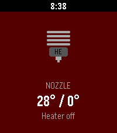
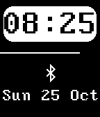

<!-- Generated by scripts/update_app_directory.py: do not edit by hand -->
[← All Pebble Developers](../developers.md)

# willbsp

*1 watchface and 1 app · Last updated 2026-10-11 · [About these lists](../about-app-lists.md)*

Links: [Pebble App Store](https://apps.repebble.com/apps/dev/willbsp_5609aa4ebcd03bd488000090) · [GitHub (willbsp)](https://github.com/willbsp)

<button type="button" data-filter="all" aria-pressed="true">All 2</button><button type="button" data-filter="watchface" aria-pressed="false">Watchfaces 1</button><button type="button" data-filter="watchapp" aria-pressed="false">Apps 1</button>

<label class="dev-sort">Sort by <select><option value="updated">Recently updated</option><option value="released">Newest release</option><option value="title">A–Z</option></select></label>

<h2 class="app-name" id="app-a363f7be311a4480831ab357"><a href="https://apps.repebble.com/a363f7be311a4480831ab357">Klipper Monitor</a> v0.1.0</h2>
<a class="app-source" href="https://github.com/willbsp/klipper-pebble" title="Source code" data-search-exclude>View source</a>

App

Released 2026-05-28 Updated 2026-05-28

Runs on: Time 2

Monitor your Klipper 3D printer

<h2 class="app-name" id="app-562c9639b5a9327f9d000065"><a href="https://apps.repebble.com/562c9639b5a9327f9d000065">Simple Retro</a> v2.0</h2>
<a class="app-source" href="https://github.com/willbsp/Simple-Retro-Pebble" title="Source code" data-search-exclude>View source</a>

Watchface

Released 2015-10-25 Updated 2016-03-28

Runs on: Time 2, Pebble 2 Duo, Pebble 2, Time, Classic

Simple Retro is a simple open-source Pebble watchface that can show Bluetooth status, battery level, time and date.

