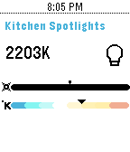
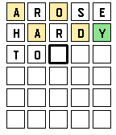
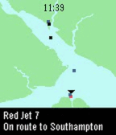

<!-- Generated by scripts/update_app_directory.py: do not edit by hand -->
[← All Pebble Developers](../developers.md)

# Willow Systems

*4 apps · Last updated 2026-10-12 · [About these lists](../about-app-lists.md)*

Links: [Rebble App Store](https://apps.rebble.io/en_US/developer/5d9ac26cc393f54d6b5f5443/1) · [GitHub (Willow-Systems)](https://github.com/Willow-Systems) · [Website (willow.systems)](https://willow.systems/ha)

<button type="button" data-filter="all" aria-pressed="true">All 4</button><button type="button" data-filter="watchface" aria-pressed="false" disabled>Watchfaces 0</button><button type="button" data-filter="watchapp" aria-pressed="false">Apps 4</button>

<label class="dev-sort">Sort by <select><option value="updated">Recently updated</option><option value="released">Newest release</option><option value="title">A–Z</option></select></label>

<h2 class="app-name" id="app-637a99d0fdf3e30009f6397d"><a href="https://apps.rebble.io/en_US/application/637a99d0fdf3e30009f6397d">Home Assistant</a> v1.4</h2>
<a class="app-source" href="https://github.com/Willow-Systems/pebble-home-assistant" title="Source code" data-search-exclude>View source</a>

App

MIT Released 2022-11-20 Updated 2023-06-06 Rebble App Store

Runs on: Round 2, Time 2, Pebble 2 Duo, Pebble 2, Time Round, Time

A full-feature Pebble app for Home Assistant! (see home-assistant.io) With this app you can: - Quickly toggle lights - Control light brightness &amp; colour temperature - Control switches &amp; input…

<h2 class="app-name" id="app-622e0e5a4a1ad20009ffd783"><a href="https://apps.rebble.io/en_US/application/622e0e5a4a1ad20009ffd783">Wordle</a> v2.1</h2>
<a class="app-source" href="https://github.com/Willow-Systems/wordle-for-pebble" title="Source code" data-search-exclude>View source</a>

App

No licence Released 2022-03-13 Updated 2022-03-16 Rebble App Store

Runs on: Time 2, Time

It&#x27;s Wordle on your wrist! (But totally unofficial) This clone of the popular game Wordle lets you play with the same word as the real thing, but on your wrist! - Your score for the day is saved…

<h2 class="app-name" id="app-61751f160ff21d000a08d921"><a href="https://apps.rebble.io/en_US/application/61751f160ff21d000a08d921">Ferry Tracker</a> v1.1</h2>
<a class="app-source" href="https://github.com/Willow-Systems/red-funnel-pebble" title="Source code" data-search-exclude>View source</a>

App

No licence Released 2021-10-24 Updated 2021-11-06 Rebble App Store

Runs on: Time 2, Pebble 2 Duo, Pebble 2, Time, Classic

This app tracks the location of Red Funnel ferries in the UK, between the mainland and the Isle of Wight. It&#x27;s a recreation of the tracker on their website at…

<h2 class="app-name" id="app-5d9ac26dc393f54d6b5f5445"><a href="https://apps.rebble.io/en_US/application/5d9ac26dc393f54d6b5f5445">Generate Token</a> v1.0</h2>
<a class="app-source" href="https://github.com/Willow-Systems/pebble-generate-token/" title="Source code" data-search-exclude>View source</a>

App

No licence Released 2019-10-07 Updated 2019-10-07 Rebble App Store

Runs on: Round 2, Time 2, Pebble 2 Duo, Pebble 2, Time Round, Time, Classic

Simply generate a rebble timeline token for use with services that require it. Once you have run the watchapp, open the app settings on your phone to easily copy and paste the token.

