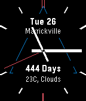

<!-- Generated by scripts/update_app_directory.py: do not edit by hand -->
[← All Pebble Developers](../developers.md)

# willwoz

*1 watchface · Last updated 2026-10-11 · [About these lists](../about-app-lists.md)*

Links: [Pebble App Store](https://apps.repebble.com/apps/dev/willwoz_568f17b4056c38f65e00001f) · [GitHub (willwoz)](https://github.com/willwoz)

<h2 class="app-name" id="app-56a008b742c3a13be8000065"><a href="https://apps.repebble.com/56a008b742c3a13be8000065">DayFace</a> v7</h2>
<a class="app-source" href="https://github.com/willwoz/DayFace" title="Source code" data-search-exclude>View source</a>

Watchface

Released 2016-01-20 Updated 2016-10-09

Runs on: Round 2, Time 2, Pebble 2 Duo, Pebble 2, Time Round, Time, Classic

Simple, clean watch face that now has hands and digits, and counts days up or down, for anyone who needs to count days up or down. Configurable battery and connection alert, and background and…

