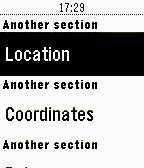

<!-- Generated by scripts/update_app_directory.py: do not edit by hand -->
[← All Pebble Developers](../developers.md)

# willyb321

*2 apps · Last updated 2026-10-12 · [About these lists](../about-app-lists.md)*

Links: [Pebble App Store](https://apps.repebble.com/apps/dev/willyb321_54fe3b87807d278084000062) · [GitHub (willyb321)](https://github.com/willyb321) · [Website (tehsuperwilly.tech)](https://tehsuperwilly.tech)

<button type="button" data-filter="all" aria-pressed="true">All 2</button><button type="button" data-filter="watchface" aria-pressed="false" disabled>Watchfaces 0</button><button type="button" data-filter="watchapp" aria-pressed="false">Apps 2</button>

<label class="dev-sort">Sort by <select><option value="updated">Recently updated</option><option value="released">Newest release</option><option value="title">A–Z</option></select></label>

<h2 class="app-name" id="app-581d55cb1c0888f2a400016f"><a href="https://apps.repebble.com/581d55cb1c0888f2a400016f">Elite Status</a> v1.2</h2>
<a class="app-source" href="https://github.com/willyb321/pebble-edsm" title="Source code" data-search-exclude>View source</a>

App

Released 2016-11-05 Updated 2016-11-08

Runs on: Time 2, Pebble 2 Duo, Pebble 2, Time, Classic

Check your stats in Elite: Dangerous. Uses EDSM.

<h2 class="app-name" id="app-565260877984de09c6000008"><a href="https://apps.repebble.com/565260877984de09c6000008">TimeTable</a> v2.5</h2>
<a class="app-source" href="https://github.com/willyb321/pebble-timetable_c" title="Source code" data-search-exclude>View source</a>

App

Released 2015-11-23 Updated 2016-02-01

Runs on: Round 2, Time 2, Pebble 2 Duo, Pebble 2, Time Round, Time, Classic

Made this for my friend.

