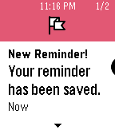

<!-- Generated by scripts/update_app_directory.py: do not edit by hand -->
[← All Pebble Developers](../developers.md)

# Wristy Business

*1 app · Last updated 2026-10-11 · [About these lists](../about-app-lists.md)*

Links: [Pebble App Store](https://apps.repebble.com/apps/dev/wristy-business_52f0096f61b75268a1000052) · [GitHub (hipsterbrown)](https://github.com/hipsterbrown)

<h2 class="app-name" id="app-5620a39525ef793651000045"><a href="https://apps.repebble.com/5620a39525ef793651000045">Slate</a> v1.1</h2>
<a class="app-source" href="https://github.com/hipsterbrown/slate" title="Source code" data-search-exclude>View source</a>

App

Released 2015-10-16 Updated 2019-07-24

Runs on: Round 2, Time 2, Time Round, Time

Apple has Siri. Microsoft has Cortana. Now Pebble has Slate. Instantly add reminders to your Pebble Timeline simply by telling Slate what you need. Say &quot;Remind me to/about &lt;task&gt; at/on…

