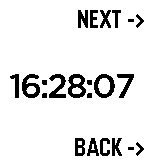

<!-- Generated by scripts/update_app_directory.py: do not edit by hand -->
[← All Pebble Developers](../developers.md)

# WuerfelDev

*1 watchface and 1 app · Last updated 2026-10-12 · [About these lists](../about-app-lists.md)*

Links: [Pebble App Store](https://apps.repebble.com/apps/dev/wuerfeldev_56dab64f59ab332abd00000b) · [GitHub (WuerfelDev)](https://github.com/WuerfelDev)

<button type="button" data-filter="all" aria-pressed="true">All 2</button><button type="button" data-filter="watchface" aria-pressed="false">Watchfaces 1</button><button type="button" data-filter="watchapp" aria-pressed="false">Apps 1</button>

<label class="dev-sort">Sort by <select><option value="updated">Recently updated</option><option value="released">Newest release</option><option value="title">A–Z</option></select></label>

<h2 class="app-name" id="app-56f1a4021fd1e75549000017"><a href="https://apps.repebble.com/56f1a4021fd1e75549000017">LIFT</a> v1.4</h2>
<a class="app-source" href="https://github.com/WuerfelDev/LIFT/" title="Source code" data-search-exclude>View source</a>

Watchface

MIT Released 2016-03-22 Updated 2025-03-04

Runs on: Round 2, Time 2, Pebble 2 Duo, Pebble 2, Time Round, Time, Classic

This watchface is simply beautiful. You can choose between 12h and 24h clock in the pebble settings. While one hour pass, the red panel which shows the time, slides from the top (when the hour…

<h2 class="app-name" id="app-56f56ae8acd389e632000052"><a href="https://apps.repebble.com/56f56ae8acd389e632000052">PowerPoint Presenter</a> v1.0</h2>
<a class="app-source" href="https://github.com/WuerfelDev/PPP" title="Source code" data-search-exclude>View source</a>

App

MIT Released 2016-03-25 Updated 2016-03-26

Runs on: Round 2, Time 2, Pebble 2 Duo, Pebble 2, Time Round, Time, Classic

ONLY ANDROID This watchapp lets you do the PC&#x27;s PowerPoint/LibreOffice/OpenOffice -presentations NEXT and BACK functions. Additionally the time is displayed to have everything under control. What…

