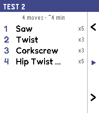
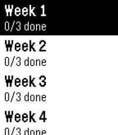

<!-- Generated by scripts/update_app_directory.py: do not edit by hand -->
[← All Pebble Developers](../developers.md)

# Wyoc

*3 apps · Last updated 2026-10-12 · [About these lists](../about-app-lists.md)*

Links: [Pebble App Store](https://apps.repebble.com/apps/dev/wyoc_6bce85d8ae51db9b0f0f1959) · [Rebble App Store](https://apps.rebble.io/en_US/developer/56327d227d13f9d558000078/1) · [GitHub (Wyoc)](https://github.com/Wyoc)

<button type="button" data-filter="all" aria-pressed="true">All 3</button><button type="button" data-filter="watchface" aria-pressed="false" disabled>Watchfaces 0</button><button type="button" data-filter="watchapp" aria-pressed="false">Apps 3</button>

<label class="dev-sort">Sort by <select><option value="updated">Recently updated</option><option value="released">Newest release</option><option value="title">A–Z</option></select></label>

<h2 class="app-name" id="app-61262da242074a6a8009efed"><a href="https://apps.repebble.com/61262da242074a6a8009efed">Pilatable</a> v1.0.0</h2>
<a class="app-source" href="https://github.com/Wyoc/pilatable" title="Source code" data-search-exclude>View source</a>

App

No licence Released 2026-06-18 Updated 2026-06-18

Runs on: Time 2

Guided Pilates mat workouts on your wrist, paced by your breath. Pilatable turns your Pebble Time 2 into a calm, glanceable Pilates coach. Instead of staring at a screen, you follow your breath…

<h2 class="app-name" id="app-b0593b021ec14a9fb33207e5"><a href="https://apps.repebble.com/b0593b021ec14a9fb33207e5">Anki-pebble</a> v1.0.1</h2>
<a class="app-source" href="https://github.com/Wyoc/anki-pebble-watch" title="Source code" data-search-exclude>View source</a>

App

GPL-3.0 Released 2026-06-04 Updated 2026-06-17

Runs on: Time 2, Pebble 2 Duo, Pebble 2

Review your AnkiDroid flashcards from your wrist. Requires the free Anki-Pebble companion app.

<h2 class="app-name" id="app-69f5d27a8bb70b00099fc067"><a href="https://apps.rebble.io/en_US/application/69f5d27a8bb70b00099fc067">pebble-c25k</a> v1.1.1</h2>
<a class="app-source" href="https://github.com/Wyoc/pebble-c25k" title="Source code" data-search-exclude>View source</a>

App · <a href="https://forum.rebble.io/t/936" title="Discuss this app on the Rebble forum" data-search-exclude>Forum thread</a>

No licence Released 2026-05-02 Updated 2026-05-02 Rebble App Store

Runs on: Round 2, Time 2, Pebble 2 Duo, Pebble 2, Time Round, Time, Classic

A pebble 2 C25K watchapp

