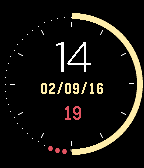

<!-- Generated by scripts/update_app_directory.py: do not edit by hand -->
[← All Pebble Developers](../developers.md)

# Xander Dumaine

*1 watchface · Last updated 2026-10-11 · [About these lists](../about-app-lists.md)*

Links: [Pebble App Store](https://apps.repebble.com/apps/dev/xander-dumaine_550e2f975a64e7320c000087) · [GitHub (xdumaine)](https://github.com/xdumaine)

<h2 class="app-name" id="app-56bb47a3c0d1547f7e00000f"><a href="https://apps.repebble.com/56bb47a3c0d1547f7e00000f">Polar UTC</a> v1.0</h2>
<a class="app-source" href="https://github.com/xdumaine/pebble-polar-utc" title="Source code" data-search-exclude>View source</a>

Watchface

Released 2016-02-10 Updated 2016-02-10

Runs on: Time 2, Time

The watchface shows the local time hour in large text, followed by the current date, followed by the UTC hour. Minutes are represented by the arc around the outside. Every 5 minutes, the arc…

