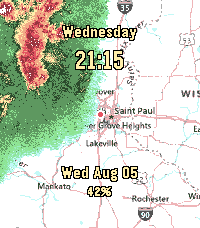

<!-- Generated by scripts/update_app_directory.py: do not edit by hand -->
[← All Pebble Developers](../developers.md)

# xd1936

*1 watchface · Last updated 2026-10-11 · [About these lists](../about-app-lists.md)*

Links: [Pebble App Store](https://apps.repebble.com/apps/dev/xd1936_7108e8441ce1f288017120ec) · [GitHub (leoherzog)](https://github.com/leoherzog)

<h2 class="app-name" id="app-2029ab9c84f946e1b125f8e0"><a href="https://apps.repebble.com/2029ab9c84f946e1b125f8e0">NOAA US Weather Radar</a> v1.2.1</h2>
<a class="app-source" href="https://github.com/leoherzog/pebble-noaa-radar-watchface" title="Source code" data-search-exclude>View source</a>

Watchface

Released 2026-08-15 Updated 2026-10-04

Runs on: Round 2, Time 2, Time Round, Time

Live NOAA base reflectivity radar on top of a USGS topographic map, centered on your location or a specified location. Customize with time, date, health stats, and/or National Weather Service…

