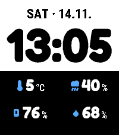
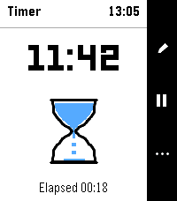
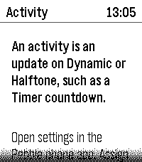
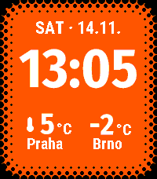
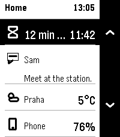

<!-- Generated by scripts/update_app_directory.py: do not edit by hand -->
[← All Pebble Developers](../developers.md)

# xefensor

*2 watchfaces and 3 apps · Last updated 2026-11-23 · [About these lists](../about-app-lists.md)*

Links: [Pebble App Store](https://apps.repebble.com/apps/dev/xefensor_d401482e372dff79d360c099) · [GitHub (xefensor)](https://github.com/xefensor) · [Website (xefensor.github.io)](https://xefensor.github.io/xoce/projects/dynamic/)

<button type="button" data-filter="all" aria-pressed="true">All 5</button><button type="button" data-filter="watchface" aria-pressed="false">Watchfaces 2</button><button type="button" data-filter="watchapp" aria-pressed="false">Apps 3</button>

<label class="dev-sort">Sort by <select><option value="updated">Recently updated</option><option value="released">Newest release</option><option value="title">A–Z</option></select></label>

<h2 class="app-name" id="app-5db601a9303a4eb7baa90331"><a href="https://apps.repebble.com/5db601a9303a4eb7baa90331">Dynamic</a> v1.0.3</h2>
<a class="app-source" href="https://github.com/xefensor/pebble-watchface-dynamic" title="Source code" data-search-exclude>View source</a>

Watchface

Other Released 2026-11-13 Updated 2026-11-20

Runs on: Round 2, Time 2

A Pebble watchface that makes room for your day. Keep a clear clock above your chosen readings. When music or a countdown is active, Dynamic rearranges the space to show it alongside the time. …

<h2 class="app-name" id="app-2f8f8cfd4e7e442fb724dac7"><a href="https://apps.repebble.com/2f8f8cfd4e7e442fb724dac7">Timer</a> v1.0.3</h2>
<a class="app-source" href="https://github.com/xefensor/pebble-app-timer" title="Source code" data-search-exclude>View source</a>

App

Other Released 2026-11-13 Updated 2026-11-14

Runs on: Round 2, Time 2

Reusable countdowns, right on your Pebble. Save up to eight timers and control them with the watch buttons. Choose hours, minutes and seconds, start a countdown, then keep its duration ready for…

<h2 class="app-name" id="app-59af0a59f7a34cb09a79bcbe"><a href="https://apps.repebble.com/59af0a59f7a34cb09a79bcbe">Open Activity</a> v1.0.2</h2>
<a class="app-source" href="https://github.com/xefensor/pebble-app-open-activity" title="Source code" data-search-exclude>View source</a>

App

Other Released 2026-11-13 Updated 2026-11-14

Runs on: Round 2, Time 2

A button shortcut from your watchface to the app behind its activity. See a Timer countdown on Dynamic or Halftone, then use a Quick Launch shortcut to open Timer. Open Activity uses recent…

<h2 class="app-name" id="app-48d7f4eab704414c8bc1fa7e"><a href="https://apps.repebble.com/48d7f4eab704414c8bc1fa7e">Halftone</a> v1.10.3</h2>
<a class="app-source" href="https://github.com/xefensor/halftone-watchface" title="Source code" data-search-exclude>View source</a>

Watchface

Other Released 2026-10-04 Updated 2026-11-14

Runs on: Round 2, Time 2

A bold Pebble clock with a halftone dot border. Halftone puts a distinctive clock and two useful readings on your wrist. Choose weather, battery or other compatible Pebble readings, then make the…

<h2 class="app-name" id="app-603d814e961c40308c98ce63"><a href="https://apps.repebble.com/603d814e961c40308c98ce63">Dashboard</a> v1.0.2</h2>
<a class="app-source" href="https://github.com/xefensor/pebble-app-dashboard" title="Source code" data-search-exclude>View source</a>

App

Other Released 2026-11-13 Updated 2026-11-14

Runs on: Round 2, Time 2

Your activity, notifications and pinned readings in one Pebble overview. Open Dashboard for a quick look at one activity, a notification panel and two pinned items. Browse the full collections…

