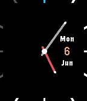

<!-- Generated by scripts/update_app_directory.py: do not edit by hand -->
[← All Pebble Developers](../developers.md)

# xeric

*1 watchface · Last updated 2026-10-12 · [About these lists](../about-app-lists.md)*

Links: [Pebble App Store](https://apps.repebble.com/apps/dev/xeric_5725992d6122504557000001) · [GitHub (xeric)](https://github.com/xeric)

<h2 class="app-name" id="app-57553f4f103a34bcd5000023"><a href="https://apps.repebble.com/57553f4f103a34bcd5000023">Yet Another Thin</a> v2.0</h2>
<a class="app-source" href="https://github.com/xeric/YAThin" title="Source code" data-search-exclude>View source</a>

Watchface

Released 2016-06-06 Updated 2016-06-06

Runs on: Round 2, Time 2, Pebble 2 Duo, Pebble 2, Time Round, Time, Classic

Yet Another Thin is developed and improved based on open source Watchface &#x27;Thin&#x27;, and add some small changes on it, includes: cross center hands, Bluetooth indicator(12 clock marker), red hour…

