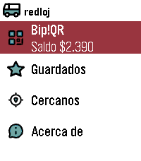

<!-- Generated by scripts/update_app_directory.py: do not edit by hand -->
[← All Pebble Developers](../developers.md)

# xorcl

*1 app · Last updated 2026-10-12 · [About these lists](../about-app-lists.md)*

Links: [Pebble App Store](https://apps.repebble.com/apps/dev/xorcl_53134ca2bb31cf87cd000254)

<h2 class="app-name" id="app-54bc4ded53e5a72ad60000b0"><a href="https://apps.repebble.com/54bc4ded53e5a72ad60000b0">Redloj - Bip!QR e Itinerario</a> v3.0.0</h2>
<a class="app-source" href="https://git.7709.cl/e/redloj" title="Source code" data-search-exclude>View source</a>

App

Released 2015-01-19 Updated 2026-09-05

Runs on: Round 2, Time 2, Pebble 2 Duo, Pebble 2, Time Round, Time, Classic

English: (This application was called &quot;Transanpbl&quot; and then &quot;Redpbl&quot;. It maintains that functionality, adding Bip!QR payments) Santiago de Chile&#x27;s Public Bus System (Also known as Red Movilidad)…

