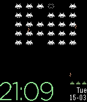

<!-- Generated by scripts/update_app_directory.py: do not edit by hand -->
[← All Pebble Developers](../developers.md)

# XWolfOverride

*4 watchfaces · Last updated 2026-10-12 · [About these lists](../about-app-lists.md)*

Links: [Pebble App Store](https://apps.repebble.com/apps/dev/xwolfoverride_54469025c952a3161f00007d) · [GitHub (XWolfOverride)](https://github.com/XWolfOverride) · [Website (xwolf.es)](http://www.xwolf.es/)

<button type="button" data-filter="all" aria-pressed="true">All 4</button><button type="button" data-filter="watchface" aria-pressed="false">Watchfaces 4</button><button type="button" data-filter="watchapp" aria-pressed="false" disabled>Apps 0</button>

<label class="dev-sort">Sort by <select><option value="updated">Recently updated</option><option value="released">Newest release</option><option value="title">A–Z</option></select></label>

<h2 class="app-name" id="app-549f4fcafefc1d9c39000262"><a href="https://apps.repebble.com/549f4fcafefc1d9c39000262">InvaClock</a> v1.3</h2>
<a class="app-source" href="https://github.com/XWolfOverride/InvaClock" title="Source code" data-search-exclude>View source</a>

Watchface

MIT Released 2014-12-28 Updated 2017-07-13

Runs on: Round 2, Time 2, Pebble 2 Duo, Pebble 2, Time Round, Time, Classic

A Watchface inspired on the great game Space Invaders™ (Trademark of Taito japan).

<h2 class="app-name" id="app-553533ac856f46533500000b"><a href="https://apps.repebble.com/553533ac856f46533500000b">Timestamp HEX</a> v1.0</h2>
<a class="app-source" href="https://github.com/XWolfOverride/Timestamp.git" title="Source code" data-search-exclude>View source</a>

Watchface

MIT Released 2015-04-20 Updated 2015-04-20

Runs on: Time 2, Pebble 2 Duo, Pebble 2, Time, Classic

Do you like Timestamp Alone, but you play even harder? This is your solution! All date information in one single line! Too fast.

<h2 class="app-name" id="app-553530902f689ec658000015"><a href="https://apps.repebble.com/553530902f689ec658000015">Timestamp Alone</a> v1.0</h2>
<a class="app-source" href="https://github.com/XWolfOverride/Timestamp" title="Source code" data-search-exclude>View source</a>

Watchface

MIT Released 2015-04-20 Updated 2015-04-20

Runs on: Time 2, Pebble 2 Duo, Pebble 2, Time, Classic

Big, clear, simply and pure unix timestamp. No distractions.

<h2 class="app-name" id="app-549f4edeef9cfa3452000278"><a href="https://apps.repebble.com/549f4edeef9cfa3452000278">L.gant</a> v1.0</h2>
<a class="app-source" href="https://github.com/XWolfOverride/L.GANT" title="Source code" data-search-exclude>View source</a>

Watchface

MIT Released 2014-12-28 Updated 2014-12-28

Runs on: Time 2, Pebble 2 Duo, Pebble 2, Time, Classic

A simply and elegant watchface.

