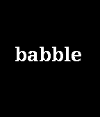

<!-- Generated by scripts/update_app_directory.py: do not edit by hand -->
[← All Pebble Developers](../developers.md)

# Yanda Huang

*1 app · Last updated 2026-10-12 · [About these lists](../about-app-lists.md)*

Links: [Pebble App Store](https://apps.repebble.com/apps/dev/yanda-huang_5667720c53e4746ab6000018) · [GitHub (yodahuang)](https://github.com/yodahuang) · [Website (yodahuang.github.io)](https://yodahuang.github.io/GRE-Reminder-Website/)

<h2 class="app-name" id="app-577b62526c21040179000074"><a href="https://apps.repebble.com/577b62526c21040179000074">GRE Reminder (with Chinese translation)</a> v0.1</h2>
<a class="app-source" href="https://github.com/yodahuang/Pebble-GRE-Word-Reminder" title="Source code" data-search-exclude>View source</a>

App

Released 2016-07-05 Updated 2016-07-05

Runs on: Time 2, Pebble 2 Duo, Pebble 2, Time, Classic

An app for Chinese users to recite GRE words for conveniently.

